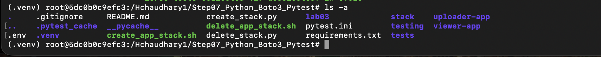
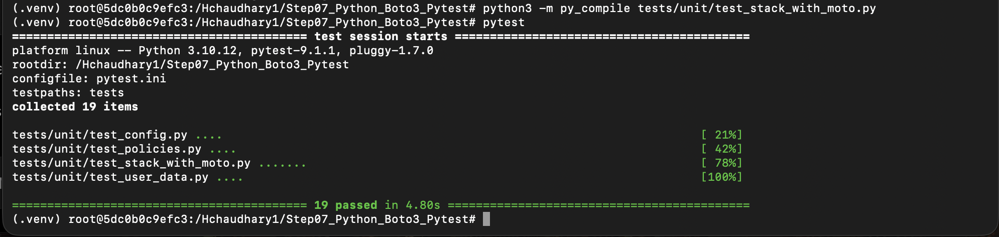
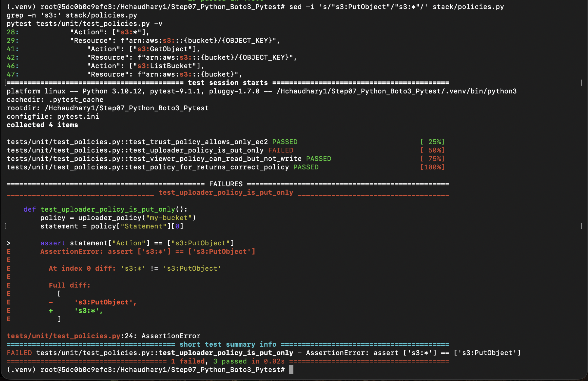
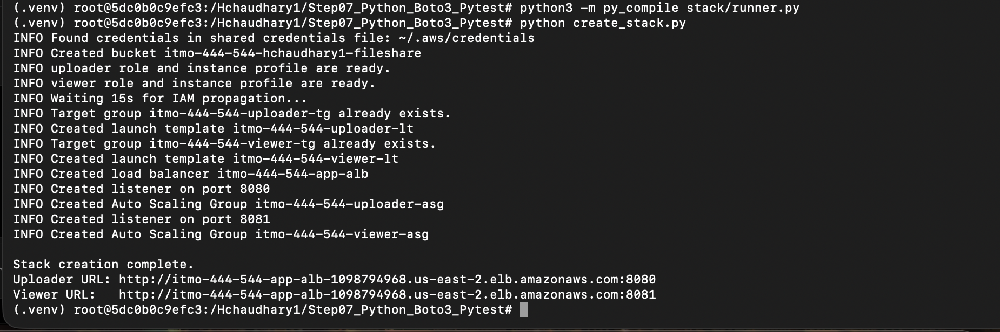
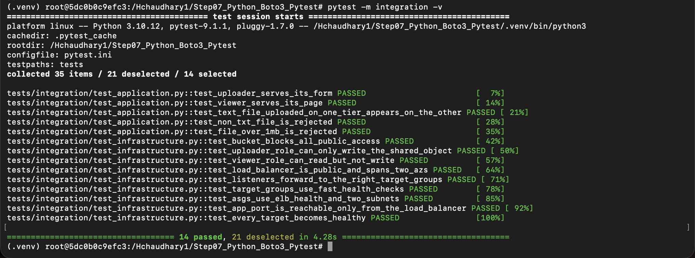
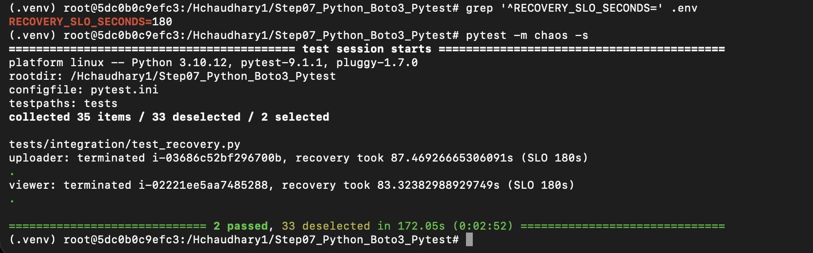
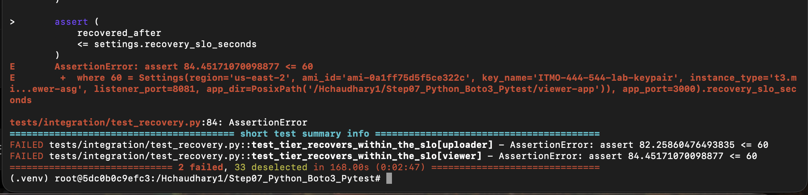
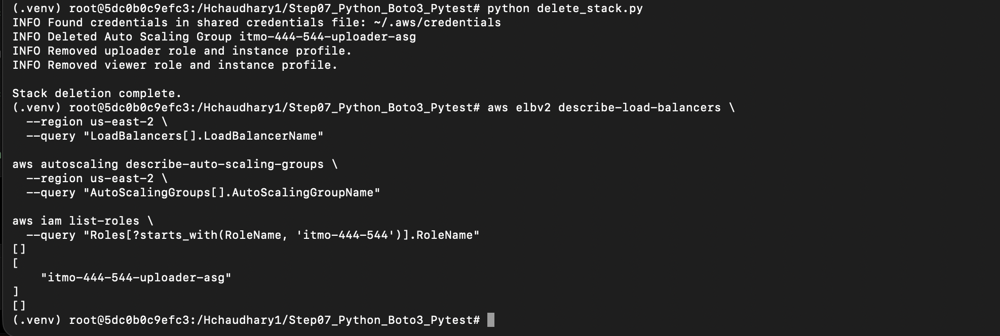
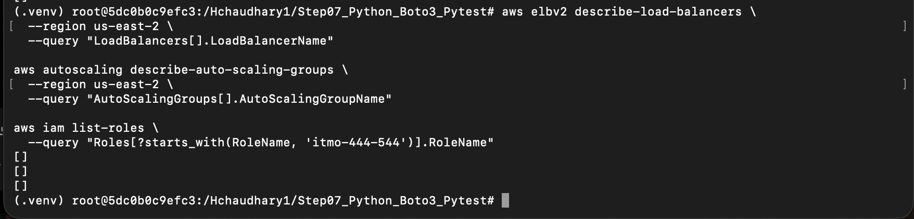
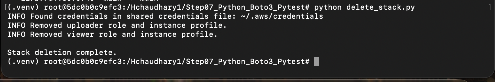

# Step07 — Infrastructure as Python with boto3 and pytest

This lab rebuilds the previous AWS CLI/Bash infrastructure stack using Python, `boto3`, `pytest`, and `moto`.

The project creates and validates a two-tier AWS application architecture with an uploader tier and a viewer tier behind an Application Load Balancer. It also includes unit testing, real AWS integration testing, chaos testing, and automated cleanup.

---

## Project Structure

The project contains Python infrastructure modules, pytest test suites, application code, Bash scripts from the earlier version of the lab, and submission screenshots.

---

## Infrastructure Created

The Python implementation creates and manages:

- S3 bucket for shared file storage
- IAM roles and instance profiles
- EC2 Launch Templates
- Application Load Balancer
- Target Groups
- Listeners on ports `8080` and `8081`
- Auto Scaling Groups for uploader and viewer tiers
- Security Group configuration
- User-data scripts for application deployment

The uploader application accepts valid text-file uploads, while the viewer application displays the shared file.

---

## Unit Testing with pytest and moto

The unit test suite validates the Python infrastructure logic without creating real AWS resources.

### Command

`pytest`

### Result

- 19 unit tests passed
- Configuration tests passed
- IAM policy tests passed
- User-data tests passed
- moto infrastructure tests passed

---

## Break-It-on-Purpose Test

To prove that the unit tests detect incorrect IAM permissions, the uploader policy was intentionally changed from:

`s3:PutObject`

to:

`s3:*`

The policy test correctly failed because the uploader role was expected to have only the least-privilege `s3:PutObject` permission.

The policy was then restored to the correct permission and all 19 unit tests passed again.

---

## Creating the Real AWS Stack

The real AWS infrastructure was deployed using:

`python create_stack.py`

The script successfully created the required resources and printed the two application URLs.

- Uploader listener: port `8080`
- Viewer listener: port `8081`

---

## Integration Testing

The integration tests validate the real AWS deployment rather than moto.

### Command

`pytest -m integration -v`

The integration test suite checks:

- S3 public access is blocked
- uploader IAM role has write-only behavior
- viewer IAM role has read-only behavior
- ALB is public and spans two Availability Zones
- listeners forward to the correct Target Groups
- Target Groups use the expected health checks
- Auto Scaling Groups use ELB health checks and multiple subnets
- application port is reachable only from the ALB
- all registered targets become healthy
- uploader and viewer HTTP applications respond correctly
- valid `.txt` upload propagates from uploader to viewer
- invalid file types are rejected
- files larger than 1 MB are rejected

### Result

`14 passed`

---

## Chaos Testing — Normal Recovery SLO

The chaos test intentionally terminates a real EC2 instance from each Auto Scaling Group and measures how long the application takes to recover.

The normal recovery SLO was:

`RECOVERY_SLO_SECONDS=180`

### Command

`pytest -m chaos -s`

### Observed Recovery Times

- Uploader tier: approximately 87 seconds
- Viewer tier: approximately 83 seconds

Both tiers recovered within the 180-second SLO.

---

## Chaos Testing — Tightened SLO Failure

The recovery SLO was intentionally reduced to:

`RECOVERY_SLO_SECONDS=60`

Because the infrastructure normally required approximately 82–84 seconds to recover, both tests correctly failed against the stricter 60-second requirement.

This demonstrates that the chaos test is actually measuring recovery time rather than simply returning a passing result.

After this test, the SLO was restored to `180` seconds.

---

## Stack Cleanup

The Python cleanup script was executed using:

`python delete_stack.py`

The cleanup process removed the lab resources. Because AWS resource deletion is asynchronous, one Auto Scaling Group was still visible briefly immediately after the first cleanup command completed.

After AWS finished processing the deletion, a final verification was performed using AWS CLI commands.

The final checks returned empty arrays for:

- Application Load Balancers
- Auto Scaling Groups
- lab IAM roles

This confirmed that the remaining Auto Scaling Group had finished deleting and that no lab resources remained.

### Idempotent Cleanup Verification

The cleanup script was executed again after the AWS resources had already been removed.

`python delete_stack.py`

The second execution completed successfully without errors, demonstrating that the Python cleanup process is idempotent and safe to run repeatedly.

## Final Results

| Test / Validation | Result |
|---|---|
| Unit tests | 19 passed |
| Integration tests | 14 passed |
| Chaos test with 180s SLO | 2 passed |
| Chaos test with 60s SLO | 2 intentionally failed |
| Final AWS cleanup | Verified |

---

## What moto Proved and What It Could Not Prove

Moto proved that the Python stack code could call AWS-style APIs with valid parameters, that the create operations were idempotent, that delete operations could safely be repeated, and that resources ended up with the configuration expected by the unit tests.

Moto could not prove that real AWS would behave exactly the same under IAM propagation delays, service quotas, EC2 boot time, npm installation, networking, or real HTTP traffic.

The integration tests filled this gap by testing the actual deployed AWS infrastructure and application behavior, while the chaos tests verified whether the application recovered from EC2 instance failure within the defined recovery SLO.

---

## `ignore_errors()` Compared with Bash `2>/dev/null || true`

`ignore_errors("EntityAlreadyExists")` is safer than Bash `2>/dev/null || true` because it ignores only the specific AWS error that is expected during an idempotent operation.

Unexpected errors such as `AccessDenied`, invalid parameters, or configuration mistakes are still raised and remain visible.

In comparison, `2>/dev/null || true` hides all error output and forces the command to appear successful, which can hide real problems.

---

## Challenge 5 — Bash Versus Python

One place where Bash was shorter was ignoring an expected failure during cleanup because `2>/dev/null || true` can be written on one line, while Python requires exception handling and checking a specific AWS error code.

The additional Python lines make the behavior safer because only expected errors are ignored while unexpected failures remain visible.

They also make the behavior easier to unit test and reuse throughout the project.

---

## Security Notes

Sensitive configuration is excluded from Git using `.gitignore`.

The repository does not commit:

- `.env`
- virtual environment files
- generated stack output files
- AWS credentials
- private key files

The project follows least-privilege IAM behavior for the uploader and viewer tiers.

---

## Technologies Used

- Python 3
- boto3
- pytest
- moto
- AWS EC2
- AWS S3
- AWS IAM
- AWS Elastic Load Balancing
- AWS Auto Scaling
- Node.js
- Bash
- Docker
- Git
- GitHub
