# Step08 — Weather Advisor in the Cloud

## ITMO 544 — Cloud Computing

This project implements a two-tier cloud application called **Weather Advisor** using Python, boto3, AWS, Node.js, PostgreSQL, external weather APIs, Google Gemini, `pytest`, and `moto`.

For the graduate ITMO 544 version of the assignment, AWS infrastructure is created and deleted using **Python and boto3** rather than Bash infrastructure scripts.

The project demonstrates:

- Python-based AWS infrastructure automation
- Two-tier cloud architecture
- Application Load Balancing
- Auto Scaling
- PostgreSQL on Amazon RDS
- AWS Systems Manager Parameter Store
- Least-privilege IAM
- National Weather Service API integration
- Google Gemini integration
- PostgreSQL-backed caching
- Lookup-history persistence
- Graceful degradation
- Unit testing with `pytest` and `moto`
- Real AWS integration testing
- Chaos testing
- Automatic EC2 replacement and recovery
- Secure networking
- Idempotent infrastructure creation
- Complete AWS resource cleanup

---

# 1. Project Overview

The application contains two services:

1. **Weather Service**
2. **Advisor Service**

The Weather service accepts a U.S. ZIP code, determines its location, retrieves forecast information from the National Weather Service API, stores lookup history and cached weather data in PostgreSQL, and returns weather information.

The Advisor service calls the Weather service and uses Google Gemini to create a clothing recommendation based on the returned weather.

Both services run on EC2 instances behind an AWS Application Load Balancer.

---

# 2. Architecture

~~~text
                              User
                               |
                               v
                  Application Load Balancer
                     /                 \
                    /                   \
           Listener 8080             Listener 8081
                |                         |
                v                         v
        Weather Target Group      Advisor Target Group
                |                         |
                v                         v
           Weather EC2               Advisor EC2
                |                         |
        +-------+-------+                 |
        |               |                 |
        v               v                 |
    Zippopotam       NWS API              |
        |                                 |
        +--------> Weather Data            |
                        |                  |
                        v                  |
                 PostgreSQL RDS            |
                                           |
                                           v
                                     Google Gemini
                                           |
                                           v
                                Clothing Recommendation
~~~

Public ALB listeners:

~~~text
8080 -> Weather Tier
8081 -> Advisor Tier
~~~

Both Node.js applications listen internally on:

~~~text
Port 3000
~~~

PostgreSQL uses:

~~~text
Port 5432
~~~

---

# 3. Request Flow

A normal Advisor request follows this path:

~~~text
User
 |
 v
ALB :8081
 |
 v
Advisor Service
 |
 v
ALB :8080
 |
 v
Weather Service
 |
 +--> PostgreSQL Cache
 |
 +--> Zippopotam API
 |
 +--> National Weather Service API
 |
 v
Weather Response
 |
 v
Advisor Service
 |
 v
Google Gemini
 |
 v
Clothing Recommendation
 |
 v
User
~~~

The Advisor communicates with the Weather tier through the ALB rather than contacting a specific Weather EC2 instance.

This keeps the application compatible with Auto Scaling because a failed Weather instance can be replaced without changing the Advisor configuration.

---

# 4. Project Structure

~~~text
Step08_Weather_Advisor/
|
|-- advisor-app/
|   |-- app.js
|   `-- package.json
|
|-- weather-app/
|   |-- app.js
|   `-- package.json
|
|-- stack/
|   |-- __init__.py
|   |-- balancer.py
|   |-- clients.py
|   |-- compute.py
|   |-- config.py
|   |-- database.py
|   |-- network.py
|   |-- outputs.py
|   |-- policies.py
|   |-- runner.py
|   |-- scaling.py
|   |-- storage.py
|   `-- util.py
|
|-- testing/
|   `-- app_smoke_test.py
|
|-- tests/
|   |-- conftest.py
|   |-- helpers.py
|   |
|   |-- unit/
|   |   |-- test_config.py
|   |   |-- test_database_with_moto.py
|   |   |-- test_policies.py
|   |   |-- test_stack_with_moto.py
|   |   `-- test_user_data.py
|   |
|   `-- integration/
|       |-- test_application.py
|       |-- test_infrastructure.py
|       `-- test_recovery.py
|
|-- screenshots/
|   |-- 01_project_structure.png
|   |-- 02_nws_weather_api.png
|   |-- 03_gemini_ssm_securestring.png
|   |-- 04_database_created.png
|   |-- 05_database_verified.png
|   |-- 06_weather_stack_created.png
|   |-- 07_advisor_gemini_success.png
|   |-- 08_iam_least_privilege.png
|   |-- 09_weather_healthy_before_chaos.png
|   |-- 10_advisor_weather_outage_502.png
|   |-- 11_weather_recovered_after_outage.png
|   |-- 12_chaos_tests_passed.png
|   |-- 13_unit_and_integration_tests_passed.png
|   |-- 14_final_cleanup_verified.png
|   |-- 15_smoke_test_9_of_9.png
|   |-- 16_weather_journal.png
|   |-- 17_psql_history.png
|   |-- 18_direct_vs_alb.png
|   |-- 19_gemini_fallback_error.png
|   |-- 20_gemini_restored_success.png
|   |-- 21_iam_policy_simulator.png
|   |-- 22_history_endpoint.png
|   |-- 23_advisor_web_page.png
|   |-- 24_cache_timing.png
|   |-- 25_db_failure_log.png
|   `-- 26_db_recovery.png
|
|-- create_database.py
|-- delete_database.py
|-- create_weather_stack.py
|-- delete_weather_stack.py
|-- pytest.ini
|-- requirements.txt
|-- README.md
|-- SUBMISSION_NOTES.md
`-- .gitignore
~~~

## Screenshot 01 — Project Structure

Command:

~~~bash
ls -R | head -40
~~~

The screenshot shows the main application, infrastructure, test, and documentation files used in the project.

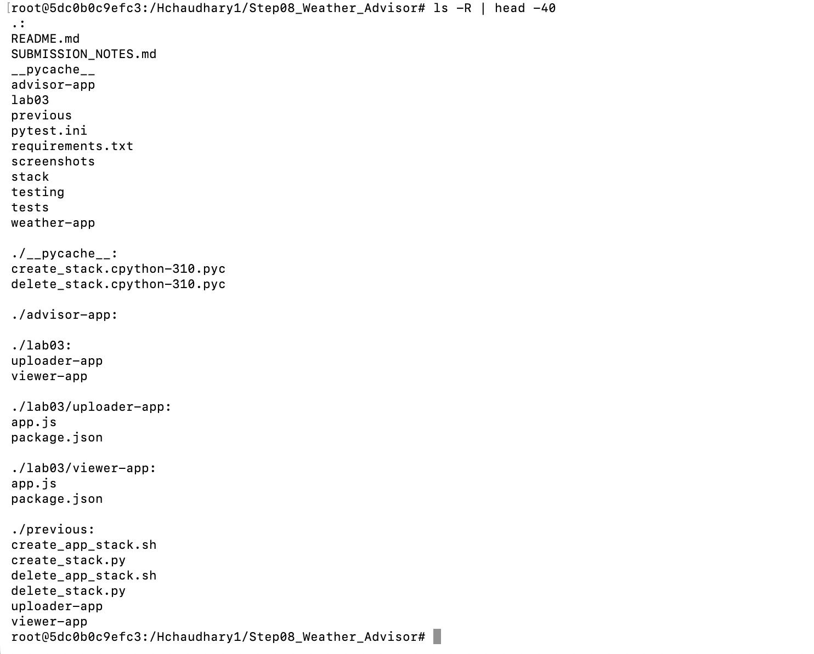

---

# 5. Python Infrastructure

The main infrastructure scripts are:

~~~text
create_database.py
delete_database.py
create_weather_stack.py
delete_weather_stack.py
~~~

All AWS resource creation and deletion for the graduate version is implemented using **Python and boto3**.

AWS CLI commands are used mainly for inspection, experiments, and verification.

The Python implementation is divided into reusable modules under `stack/` rather than placing all infrastructure logic in one large script.

---

# 6. Configuration

`stack/config.py` loads deployment configuration from `.env`.

Important configuration includes:

~~~text
AWS_REGION
AMI_ID
KEY_NAME
INSTANCE_TYPE
APP_SECURITY_GROUP_ID

AZ_A
AZ_B

WEATHER_ROLE_NAME
WEATHER_PROFILE_NAME
WEATHER_LT_NAME
WEATHER_TG_NAME
WEATHER_ASG_NAME
WEATHER_LISTENER_PORT

ADVISOR_ROLE_NAME
ADVISOR_PROFILE_NAME
ADVISOR_LT_NAME
ADVISOR_TG_NAME
ADVISOR_ASG_NAME
ADVISOR_LISTENER_PORT

ALB_NAME
ALB_SG_NAME

DB_INSTANCE_ID
DB_NAME
DB_USER
DB_SG_NAME
DB_SUBNET_GROUP_NAME
DB_PASSWORD_PARAM
CACHE_SECONDS

GEMINI_PARAM_NAME
GEMINI_MODEL
KEY_CACHE_SECONDS
CONTACT_EMAIL
~~~

Secret values are not stored directly in `.env`.

---

# 7. AWS Clients

`stack/clients.py` creates boto3 clients for services including:

~~~text
EC2
IAM
ELBv2
Auto Scaling
RDS
SSM
STS
S3
~~~

STS is used to determine the AWS account ID when IAM resource ARNs are constructed.

---

# 8. Weather Service

The Weather service uses:

~~~text
Node.js
Express
PostgreSQL
AWS SDK for SSM
~~~

Endpoints:

~~~text
GET /
GET /weather?zip=ZIPCODE
GET /history
~~~

The service handles:

- ZIP validation
- ZIP-to-coordinate lookup
- NWS weather retrieval
- PostgreSQL caching
- lookup history
- database connectivity
- structured logging
- graceful degradation when PostgreSQL is unavailable

---

# 9. ZIP Lookup and National Weather Service APIs

The Weather service first converts a ZIP code into geographic coordinates using the Zippopotam API.

Example:

~~~bash
curl -s https://api.zippopotam.us/us/60616
~~~

ZIP `60616` returns Chicago location information including latitude and longitude.

The Weather service then contacts:

~~~text
https://api.weather.gov/points/{latitude},{longitude}
~~~

The `/points` response provides another URL for the actual forecast endpoint.

Therefore, two NWS-related upstream operations are needed:

1. Request the NWS `/points/{lat},{lon}` endpoint to discover the correct forecast URL for that location.
2. Request the returned forecast URL to retrieve actual forecast-period data.

The forecast includes fields such as:

- temperature
- temperature unit
- short forecast
- wind speed
- precipitation chance
- daytime/nighttime status

A descriptive User-Agent is included in NWS requests.

## Screenshot 02 — NWS Weather API

Command:

~~~bash
curl -s -H "User-Agent: $UA" "$FORECAST_URL" | python3 -m json.tool | head -40
~~~

The returned JSON proves that the NWS forecast endpoint successfully returned weather data.

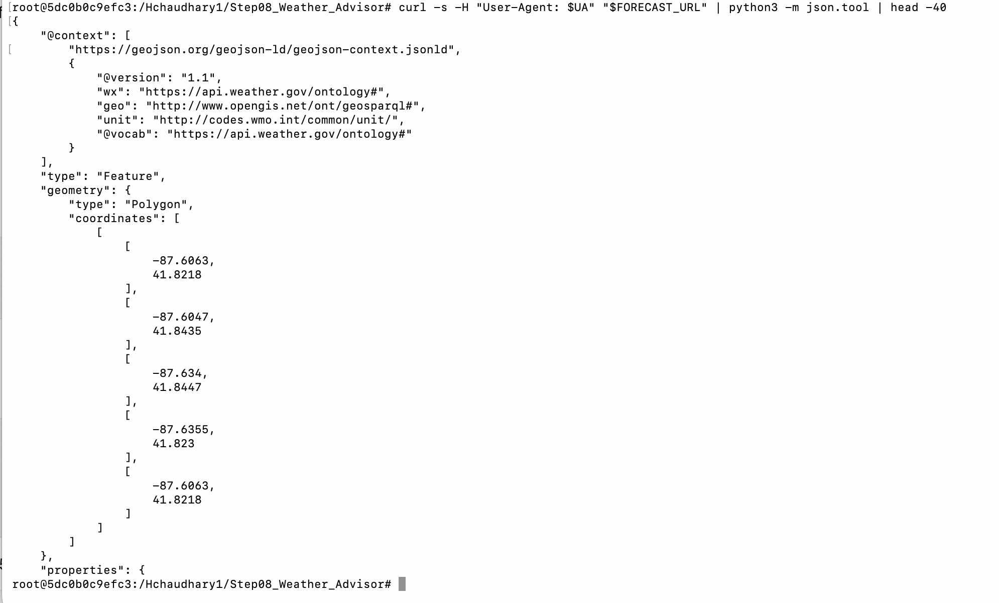

---

# 10. Weather Endpoint

Main endpoint:

~~~text
GET /weather?zip=60616
~~~

Example:

~~~bash
curl -i "http://$ALB_DNS_NAME:8080/weather?zip=60616"
~~~

Example response:

~~~json
{
  "zip": "60616",
  "city": "Chicago",
  "state": "IL",
  "forecast": {
    "temperature": 50,
    "temperatureUnit": "F",
    "shortForecast": "Mostly Clear"
  },
  "cache": "miss"
}
~~~

A later request can return:

~~~json
{
  "cache": "hit"
}
~~~

---

# 11. PostgreSQL RDS Database

The Weather tier uses PostgreSQL on Amazon RDS.

The database stores:

- cached weather responses
- lookup history

Required database configuration:

~~~text
Engine: PostgreSQL
Instance Class: db.t4g.micro
Storage: 20 GB
Storage Type: gp2
Storage Encrypted: Yes
Publicly Accessible: No
Multi-AZ: No
Backup Retention: 0
Automated Backups: Disabled
~~~

---

# 12. Database Creation

Command:

~~~bash
python3 create_database.py
~~~

The script performs the following operations:

~~~text
1. Finds the default VPC and required subnets
2. Creates or reuses the database security group
3. Creates or reuses the DB subnet group
4. Generates the database password
5. Stores the password in SSM Parameter Store
6. Creates the PostgreSQL RDS instance
7. Waits for the instance to become available
8. Saves the database endpoint for the application stack
~~~

## Screenshot 04 — Database Created

The creation output confirms:

~~~text
Database is private
Database is encrypted
Database is single-AZ
Automated backups are OFF
~~~

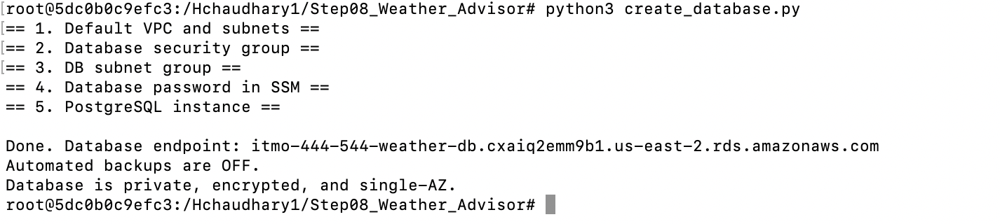

---

# 13. Database Verification

Verification command:

~~~bash
aws rds describe-db-instances \
  --db-instance-identifier "$DB_INSTANCE_ID" \
  --query "DBInstances[0].{Class:DBInstanceClass,Engine:Engine,MultiAZ:MultiAZ,Public:PubliclyAccessible,Encrypted:StorageEncrypted,BackupRetentionDays:BackupRetentionPeriod}" \
  --output table
~~~

Expected configuration:

~~~text
DBInstanceClass: db.t4g.micro
Engine: postgres
MultiAZ: False
PubliclyAccessible: False
StorageEncrypted: True
BackupRetentionPeriod: 0
~~~

Database snapshots and automated backups were also checked.

## Screenshot 05 — Database Verification

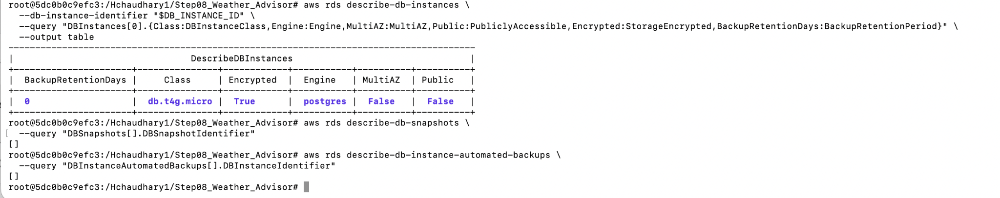

---

# 14. Database Security

PostgreSQL listens on:

~~~text
TCP 5432
~~~

The DB Security Group permits TCP port `5432` only from the application Security Group.

It does not expose PostgreSQL to:

~~~text
0.0.0.0/0
~~~

This prevents direct public access to the RDS database.

---

# 15. Secret Storage with SSM Parameter Store

The database password is generated in Python using:

~~~python
secrets.token_hex(16)
~~~

It is stored as an SSM:

~~~text
SecureString
~~~

Parameter:

~~~text
/itmo-444-544/db-password
~~~

The Gemini API key is also stored as a SecureString:

~~~text
/itmo-444-544/gemini-api-key
~~~

Secrets are not stored in:

~~~text
GitHub
application source code
screenshots
EC2 user-data
plain-text environment configuration
~~~

Using SSM Parameter Store is safer because the secrets are encrypted at rest, retrieved only at runtime, and can be protected using IAM permissions.

If a secret were placed directly in GitHub, `.env`, EC2 user-data, or application code, it could accidentally be exposed through source history, logs, instance metadata, screenshots, or repository access.

## Screenshot 03 — Gemini SecureString

Command:

~~~bash
aws ssm describe-parameters \
  --parameter-filters "Key=Name,Values=$GEMINI_PARAM_NAME" \
  --query "Parameters[].{Name:Name,Type:Type,Tier:Tier}" \
  --output table
~~~

Expected result:

~~~text
Name: /itmo-444-544/gemini-api-key
Type: SecureString
Tier: Standard
~~~

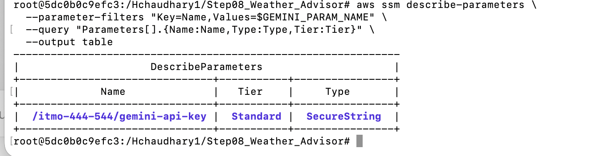

---

# 16. PostgreSQL Cache

Configured cache duration:

~~~text
CACHE_SECONDS=600
~~~

This is approximately 10 minutes.

A first lookup can return:

~~~json
{
  "cache": "miss"
}
~~~

A repeated request can return:

~~~json
{
  "cache": "hit"
}
~~~

Caching improves response speed and reduces unnecessary upstream API calls.

The cache should not be excessively long because weather changes over time. A very long TTL could cause users to receive stale forecast information.

---

# 17. Lookup History

Successful weather requests are stored in PostgreSQL.

Endpoint:

~~~text
GET /history
~~~

Example:

~~~bash
curl -s "http://$ALB_DNS_NAME:8080/history" | python3 -m json.tool
~~~

This allows the application to display previously stored weather lookups.

---

# 18. Input and Error Handling

Invalid ZIP:

~~~text
123
~~~

returns:

~~~text
HTTP 400
~~~

Unknown ZIP:

~~~text
00000
~~~

returns:

~~~text
HTTP 404
~~~

The application does not treat invalid or unknown ZIP values as successful weather requests.

---

# 19. Advisor Service

Advisor endpoint:

~~~text
GET /advice?zip=60616
~~~

Request flow:

~~~text
1. Advisor calls Weather through ALB port 8080
2. Weather returns forecast information
3. Advisor retrieves the Gemini key from SSM
4. Advisor sends selected forecast information to Gemini
5. Gemini creates clothing advice
6. Advisor returns the result to the user
~~~

The Advisor tier does not directly access PostgreSQL.

---

# 20. Google Gemini Integration

Configured model:

~~~text
gemini-3.1-flash-lite
~~~

A successful Advisor response includes:

~~~json
{
  "source": "gemini",
  "model": "gemini-3.1-flash-lite"
}
~~~

The Advisor sends weather-related data needed to create the recommendation, such as ZIP/location and public forecast information.

No database password or other AWS secret needs to be sent to Gemini.

Because the project uses a third-party AI service and a free-tier API, only the minimum data necessary for the task should be sent. Free AI services can have different retention, review, and product-improvement policies than private enterprise services, so sensitive personal or institutional information should not be included in prompts.

---

# 21. Gemini Fallback

If Gemini fails, the Advisor can still return rule-based clothing advice.

Fallback response:

~~~json
{
  "source": "fallback",
  "model": null
}
~~~

This prevents a third-party AI failure from completely breaking the application.

However, a completely silent fallback has a weakness: a persistent Gemini problem could remain unnoticed.

For that reason, the response identifies the source as `fallback`, and Gemini failures are also logged using the `gemini_error` event.

---

# 22. IAM Least Privilege

The Weather and Advisor tiers use separate IAM roles.

## Weather Role

Allowed to retrieve:

~~~text
/itmo-444-544/db-password
~~~

Not allowed to retrieve:

~~~text
/itmo-444-544/gemini-api-key
~~~

## Advisor Role

Allowed to retrieve:

~~~text
/itmo-444-544/gemini-api-key
~~~

Not allowed to retrieve:

~~~text
/itmo-444-544/db-password
~~~

This applies the principle of least privilege.

If the Advisor tier were compromised, an attacker could potentially access the Gemini key available to the Advisor role, but the Advisor role would not provide access to the PostgreSQL database password.

---

# 23. Application Load Balancer

The ALB has two listeners:

~~~text
8080 -> Weather Target Group
8081 -> Advisor Target Group
~~~

The load balancer spans two Availability Zones.

The ALB is created before the Advisor Launch Template because Advisor user-data requires the ALB DNS name to contact the Weather service.

---

# 24. Security Groups

## ALB Security Group

Allows public application traffic on:

~~~text
8080
8081
~~~

## Application Security Group

Application port:

~~~text
3000
~~~

is accessible only from the ALB Security Group.

## Database Security Group

PostgreSQL port:

~~~text
5432
~~~

is accessible only from the application Security Group.

Using a Security Group as the source is better than using a fixed IP address because Auto Scaling instances can be terminated and replaced with different IP addresses while remaining members of the same Security Group.

---

# 25. Launch Templates

The Weather Launch Template receives non-secret configuration such as:

~~~text
DB_HOST
DB_NAME
DB_USER
DB_PASSWORD_PARAM
CACHE_SECONDS
NWS_USER_AGENT
~~~

The Advisor Launch Template receives:

~~~text
WEATHER_URL
GEMINI_KEY_PARAM
GEMINI_MODEL
KEY_CACHE_SECONDS
~~~

The actual database password and Gemini API key are not inserted into EC2 user-data.

---

# 26. User-Data Size

AWS EC2 user-data must remain below the AWS size limit.

Measured sizes:

~~~text
Weather user-data: 13192 bytes
Advisor user-data: 11332 bytes
Maximum allowed: 16384 bytes
~~~

Both application launch templates stay below the limit.

---

# 27. Auto Scaling

Two Auto Scaling Groups are used:

~~~text
itmo-444-544-weather-asg
itmo-444-544-advisor-asg
~~~

Configuration:

~~~text
Minimum Capacity: 1
Maximum Capacity: 1
Desired Capacity: 1
Health Check Type: ELB
~~~

If an application EC2 instance fails, its Auto Scaling Group can create a replacement.

Application state is not stored only on the EC2 instance. Persistent lookup data is stored in RDS, which allows the application EC2 tier to remain replaceable and mostly stateless.

---

# 28. Stack Creation

Command:

~~~bash
python3 create_weather_stack.py
~~~

The Python stack creates:

~~~text
IAM roles and instance profiles
ALB Security Group
Target Groups
Application Load Balancer
Listeners
Launch Templates
Auto Scaling Groups
~~~

## Screenshot 06 — Weather Stack Created

The screenshot shows successful creation of the main application infrastructure and the Weather and Advisor URLs.

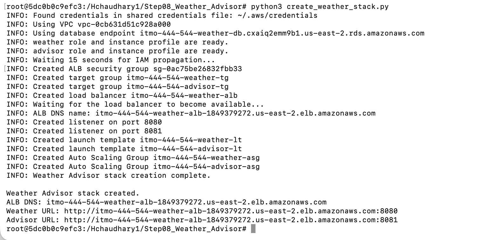

---

# 29. Advisor Gemini Success

Command:

~~~bash
curl -s "http://$ALB_DNS_NAME:8081/advice?zip=60616" | python3 -m json.tool
~~~

Important response fields include:

~~~json
{
  "source": "gemini",
  "model": "gemini-3.1-flash-lite"
}
~~~

This proves that the Advisor successfully contacted the Weather tier and Gemini.

## Screenshot 07 — Advisor Gemini Success

---

# 30. Initial IAM Policy Verification

The IAM policies were also inspected directly.

## Screenshot 08 — IAM Least Privilege

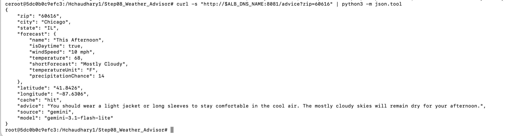

A later IAM Policy Simulator test provides stronger runtime policy evidence and is shown in Screenshot 21.

---

# 31. Idempotency

Infrastructure creation functions are designed so that they can be rerun safely.

Examples include:

- existing Security Groups can be reused
- existing DB subnet groups can be reused
- existing SSM parameters can be reused when appropriate
- existing RDS resources can be detected
- IAM roles can already exist
- deletion functions tolerate resources that are already missing

Idempotency is also tested with moto.

This is important because infrastructure code should move the environment toward the requested state instead of blindly creating duplicate resources each time it runs.

---

# 32. Unit Tests with Pytest and Moto

Unit tests use:

~~~text
pytest
moto
~~~

Command:

~~~bash
pytest -q
~~~

Result:

~~~text
27 passed
20 deselected
~~~

These tests validate infrastructure behavior without creating real AWS resources.

---

# 33. Database Moto Tests

File:

~~~text
tests/unit/test_database_with_moto.py
~~~

The tests verify required RDS configuration:

~~~text
DBInstanceClass = db.t4g.micro
Engine = PostgreSQL
AllocatedStorage = 20
BackupRetentionPeriod = 0
MultiAZ = False
PubliclyAccessible = False
StorageEncrypted = True
~~~

Database Security Group tests verify:

~~~text
Protocol = TCP
Port = 5432
Source = Application Security Group
No public IPv4 CIDR
No public IPv6 CIDR
~~~

Idempotency tests run creation logic more than once to ensure duplicate resources are not created.

Create/delete tests verify that the database and related resources can be removed correctly.

---

# 34. Integration Tests

Command:

~~~bash
pytest -q -m integration
~~~

Final result:

~~~text
18 passed
29 deselected
~~~

Integration tests verified real AWS behavior including:

- ALB active
- ALB spans two Availability Zones
- listener 8080 routes to Weather
- listener 8081 routes to Advisor
- Weather Target Group healthy
- Advisor Target Group healthy
- Auto Scaling configuration
- application port 3000 restricted
- PostgreSQL port 5432 restricted
- RDS private
- RDS encrypted
- Multi-AZ disabled
- backup retention disabled
- Weather endpoint works
- cache miss/hit behavior
- lookup history
- invalid ZIP returns 400
- unknown ZIP returns 404
- Advisor returns clothing advice
- IAM least privilege

## Screenshot 13 — Unit and Integration Tests

Result:

~~~text
27 passed, 20 deselected
18 passed, 29 deselected
~~~

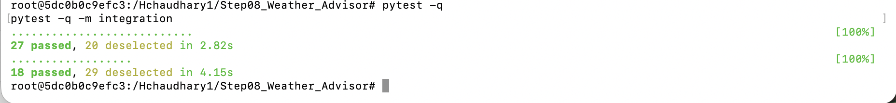

---

# 35. Chaos Testing

Two important failure scenarios were tested against real AWS infrastructure.

---

## 35.1 Database Failure

Database connectivity was intentionally removed.

The Weather service continued returning weather information with:

~~~json
{
  "cache": "unavailable"
}
~~~

This shows graceful degradation.

The database rule was later restored.

---

## 35.2 Weather EC2 Failure

Before terminating the Weather EC2 instance, the application and Target Group were verified as healthy.

### Screenshot 09 — Healthy Before Chaos

The Weather endpoint returned:

~~~text
HTTP 200
~~~

and the target was:

~~~text
healthy
~~~

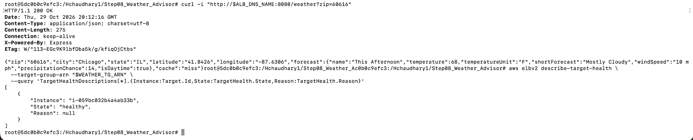

The Weather EC2 instance was then intentionally terminated.

### Screenshot 10 — Advisor During Weather Outage

Immediately after the Weather instance was terminated, the Advisor returned:

~~~text
HTTP 502 Bad Gateway
~~~

This is expected because the Advisor depends on the Weather tier and no healthy Weather target was temporarily available.

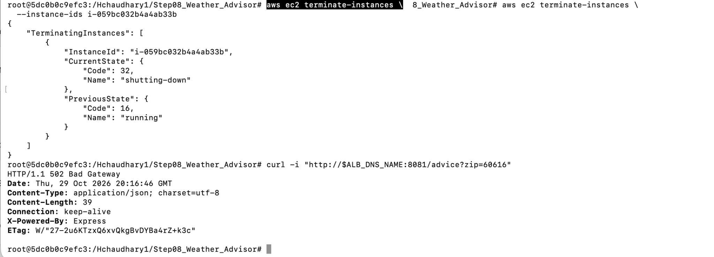

The Weather Auto Scaling Group launched a replacement instance.

### Screenshot 11 — Weather Recovered

The replacement instance eventually became:

~~~text
healthy
~~~

and Weather returned:

~~~text
HTTP 200
~~~

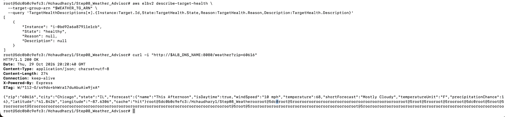

Measured recovery time:

~~~text
approximately 112.5 seconds
~~~

Required recovery objective:

~~~text
<= 300 seconds
~~~

Therefore the recovery requirement passed.

The lookup history survived the Weather EC2 replacement because the persistent application state lives in PostgreSQL RDS rather than only on the disposable EC2 instance.

---

## 35.3 Automated Chaos Test

Command:

~~~bash
pytest -q -m chaos -s
~~~

Result:

~~~text
DB outage response: 200
Weather instance terminated
Advisor 502 observed: True
Weather recovery time: approximately 112.5 seconds

2 passed
41 deselected
~~~

## Screenshot 12 — Chaos Tests Passed

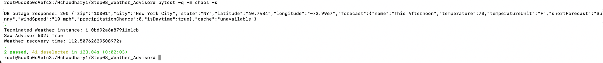

---

# 36. Required Application Smoke Test

The professor-provided application smoke test was run from the `testing` directory.

Command:

~~~bash
cd testing
python3 app_smoke_test.py
~~~

Results included:

~~~text
PASS weather tier returns a forecast
PASS repeat call is answered from the database
PASS history lists the saved lookups
PASS weather tier rejects a bad zip
PASS weather tier returns 404 for an unknown zip
PASS advisor tier returns clothing advice
PASS advice came from Gemini
PASS advisor tier rejects a bad zip
PASS advisor home page loads

9 of 9 checks passed
~~~

## Screenshot 15 — Application Smoke Test

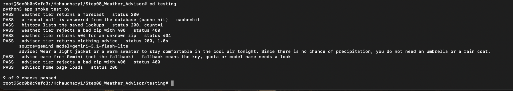

---

# 37. Weather Journal and Structured Logging

The Weather service journal was inspected directly from the running Weather EC2 instance.

Example command:

~~~bash
ssh -i /Hchaudhary1/Step04_AWS_CLI_EC2/ITMO-444-544-lab-keypair.pem \
  ec2-user@"$WEATHER_IP" \
  "sudo journalctl -u weather -n 20 --no-pager"
~~~

The logs contain structured events such as:

~~~text
weather_request
weather_success
weather_rejected
db_error
~~~

A `weather_success` event contains:

- ZIP code
- cache status
- request time in milliseconds

Example observations:

~~~text
ZIP 10001 -> cache miss -> approximately 283 ms
ZIP 90210 -> cache miss -> approximately 121 ms
ZIP 60616 -> cache hit  -> approximately 1 ms
~~~

This shows that cached requests are significantly faster than fresh upstream lookups.

## Screenshot 16 — Weather Journal

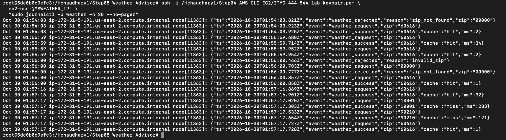

---

# 38. Direct PostgreSQL Verification

The `lookups` table was queried directly using `psql` from the Weather EC2 instance.

The password was retrieved securely from SSM and was not printed.

Example query:

~~~sql
SELECT id, zip, created_at
FROM lookups
ORDER BY id DESC
LIMIT 5;

SELECT count(*) AS saved_lookups
FROM lookups;
~~~

The query showed saved records including:

~~~text
60616
10001
90210
~~~

and confirmed that lookup data was actually stored in PostgreSQL.

## Screenshot 17 — PostgreSQL History

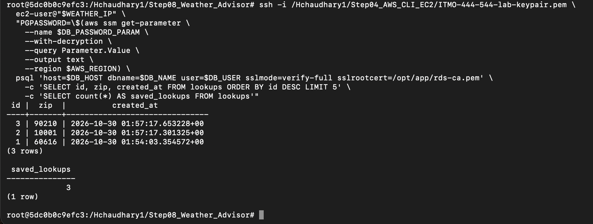

---

# 39. Direct Instance Access vs ALB

A direct request to the Weather EC2 instance on port `3000` was tested:

~~~bash
curl -m 5 -s -o /dev/null -w "direct: %{http_code}\n" \
  "http://${WEATHER_IP}:3000/"
~~~

Result:

~~~text
direct: 000
direct: no answer (good)
~~~

The same service through the ALB returned:

~~~text
through ALB: 200
~~~

This demonstrates that application traffic must pass through the ALB instead of reaching the instance directly.

Using a Security Group reference rather than a fixed IP rule is important because Auto Scaling instances can be replaced and receive different IP addresses.

## Screenshot 18 — Direct vs ALB

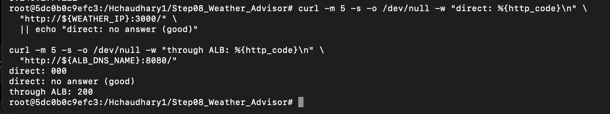

---

# 40. Gemini Failure Experiment

The Gemini credential was intentionally made invalid for the experiment.

Three Advisor requests returned rule-based fallback advice:

~~~text
fallback - Wear a warm jacket and long pants.
fallback - Wear a warm jacket and long pants.
fallback - Wear a warm jacket and long pants.
~~~

The Advisor logs recorded:

~~~text
event: gemini_error
status: 400
reason: gemini_http_error
~~~

This proves that the application detected the external AI failure while still returning useful fallback advice.

A weakness of a completely silent fallback would be that operators might not realize Gemini had stopped working. Returning a `source` value and recording `gemini_error` makes the failure visible.

## Screenshot 19 — Gemini Failure and Fallback

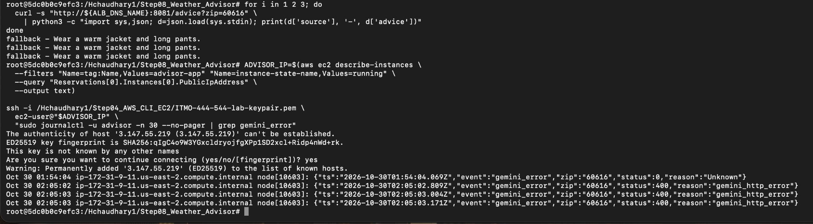

---

# 41. Gemini Recovery

After the real Gemini API key was restored, the Advisor returned:

~~~json
{
  "source": "gemini",
  "model": "gemini-3.1-flash-lite"
}
~~~

This confirmed recovery of the AI integration after the failure experiment.

## Screenshot 20 — Gemini Restored

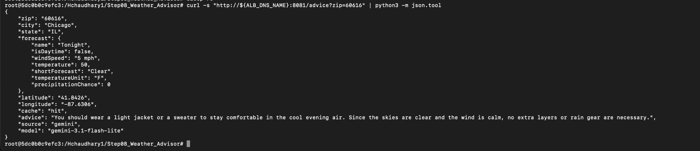

---

# 42. IAM Policy Simulator Verification

The AWS IAM Policy Simulator was used to verify both roles against both secrets.

Results:

~~~text
===== itmo-444-544-weather-role =====
DB password access : allowed
Gemini key access  : implicitDeny

===== itmo-444-544-advisor-role =====
DB password access : implicitDeny
Gemini key access  : allowed
~~~

This is stronger evidence of least privilege than only inspecting the IAM policy document.

The Weather service can access the database password but cannot access the Gemini key.

The Advisor can access the Gemini key but cannot access the database password.

## Screenshot 21 — IAM Policy Simulator

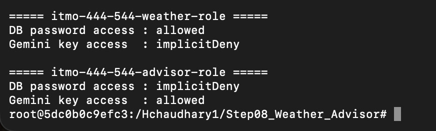

---

# 43. `/history` Endpoint Verification

Command:

~~~bash
curl -s "http://${ALB_DNS_NAME}:8080/history" | python3 -m json.tool
~~~

The endpoint returned:

~~~text
count: 4
~~~

and lookup records including:

~~~text
60616 -> Chicago, IL
90210 -> Beverly Hills, CA
10001 -> New York City, NY
~~~

This proves that the Weather service can read previously stored lookup records from PostgreSQL.

## Screenshot 22 — History Endpoint

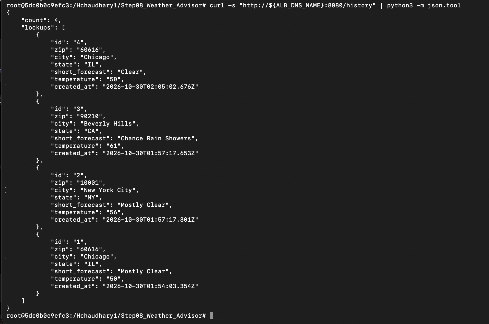

---

# 44. Advisor Web Interface

The Advisor browser page was tested using ZIP code:

~~~text
60616
~~~

The page displayed:

~~~text
Chicago, IL 60616
Tonight weather information
Gemini clothing recommendation
Suggestion source: gemini
~~~

This verifies the user-facing application in addition to the JSON `/advice` API.

## Screenshot 23 — Advisor Web Page

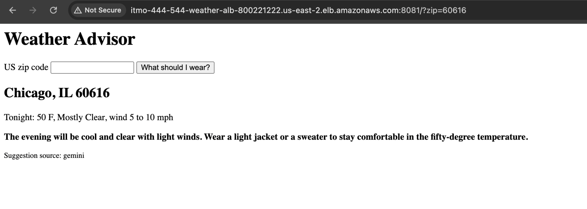

---

# 45. Cache Timing Experiment

Two consecutive Weather requests were made for ZIP:

~~~text
94105
~~~

Results:

~~~text
request 1: HTTP 200, time 0.609200s
request 2: HTTP 200, time 0.075543s
cache = hit
~~~

The first request was slower because the Weather service needed to perform upstream API work and store the response.

The second request was much faster because the result was already available from PostgreSQL cache.

A short cache reduces repeated calls to rate-limited upstream services and improves response time.

The cache should not be kept for too long because weather conditions change, and an excessively long TTL could return stale weather information.

## Screenshot 24 — Cache Timing

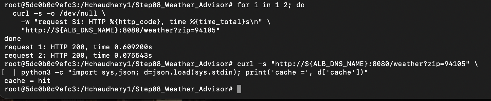

---

# 46. Database-Outage Experiment

Database access was intentionally interrupted by removing the PostgreSQL Security Group ingress rule.

The Weather service was restarted so it could not continue using an already-open DB connection.

A request for ZIP `30301` returned:

~~~text
city = Atlanta
cache = unavailable
~~~

This shows that the Weather service could still obtain fresh upstream weather information even though PostgreSQL was unavailable.

The `/history` endpoint returned:

~~~text
HTTP 503
~~~

because history requires the database.

The Weather journal recorded:

~~~text
event: db_error
stage: read
message: Connection terminated due to connection timeout
~~~

The application temporarily pauses repeated database attempts after detecting a connection failure.

This prevents every incoming request from repeatedly waiting for the same database timeout and allows the Weather tier to continue serving live forecast information while PostgreSQL is unavailable.

## Screenshot 25 — Database Failure

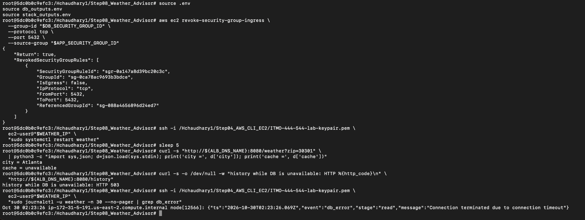

---

# 47. Database Recovery

The PostgreSQL Security Group rule was restored.

After recovery, a repeated request for Atlanta returned:

~~~text
city = Atlanta
cache = hit
~~~

This confirms that PostgreSQL connectivity and caching recovered successfully.

Persistent lookup data remains in RDS rather than on a particular EC2 instance, which supports stateless and replaceable application servers.

## Screenshot 26 — Database Recovery

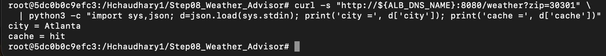

---

# 48. Why the 30-Second Database Pause Helps

Without temporary database-failure suppression, every request arriving during a PostgreSQL outage could attempt a connection and wait for the configured database timeout.

If many requests arrive during the outage, this could create:

- unnecessary latency
- repeated connection attempts
- unnecessary resource usage
- poor user experience

A temporary pause allows the Weather service to skip the failing database path for a short period and continue retrieving live weather information.

After the pause expires, the service can try PostgreSQL again and automatically recover when the database becomes reachable.

---

# 49. Backup-Retention Tradeoff

For this lab, the RDS database uses:

~~~text
BackupRetentionPeriod = 0
~~~

and deletion uses:

~~~text
SkipFinalSnapshot = True
DeleteAutomatedBackups = True
~~~

This reduces storage usage and makes laboratory cleanup easier.

The tradeoff is that there is no automated restore point, point-in-time recovery, or final database snapshot.

This configuration is acceptable for a disposable classroom environment where the data has little long-term value.

It would generally be inappropriate for an important production database because accidental deletion, corruption, or operational failure could permanently destroy valuable data.

---

# 50. Data Sent to Gemini and Privacy Considerations

The Advisor sends only weather-related information needed to generate clothing advice.

Examples include:

~~~text
ZIP/location
city/state
temperature
forecast
wind
precipitation-related weather information
~~~

The application does not need to send:

~~~text
database passwords
AWS credentials
Gemini API key
private RDS information
unrelated personal information
~~~

Because Gemini is an external AI provider, the safest design is to send the minimum amount of information needed for the task.

Free or consumer AI tiers can have different data-retention and product-improvement terms than private enterprise deployments.

For a production or institutional application, the provider's privacy, retention, training, regional-processing, and contractual policies should be reviewed before sensitive information is transmitted.

---

# 51. Security Review Questions

## 51.1 Why store secrets in SSM instead of source code or `.env`?

SSM Parameter Store allows secrets to be encrypted as SecureString values and protected using IAM.

If credentials were committed to GitHub or stored directly in source code, repository history could preserve the secret even after the current file was changed.

Secrets in EC2 user-data can also be exposed to users or processes that can inspect instance metadata or launch-template configuration.

Runtime secret retrieval reduces unnecessary exposure.

---

## 51.2 What would change if the IAM role had `ssm:*` permissions?

Giving the role:

~~~text
ssm:*
~~~

would violate least privilege.

A compromised service could potentially list, read, modify, or delete unrelated SSM parameters.

The correct approach is to allow only the required action:

~~~text
ssm:GetParameter
~~~

and only for the specific required parameter ARN.

---

## 51.3 Why is the ALB public but the application instances are not?

The ALB is the controlled public entry point.

The application instances accept port `3000` traffic only from the ALB Security Group.

This reduces the attack surface and prevents internet clients from bypassing the load balancer.

---

## 51.4 Why is the database not public?

Only the Weather tier needs PostgreSQL access.

The RDS database therefore has:

~~~text
PubliclyAccessible = False
~~~

and port `5432` is limited to the application Security Group.

There is no reason for internet users to directly contact PostgreSQL.

---

## 51.5 What is the weakness of using one application Security Group for both services?

If Weather and Advisor share the same application Security Group, a database rule that trusts the entire application Security Group can technically allow network-level DB connectivity from both types of instances.

IAM still prevents the Advisor from retrieving the DB password, but separate Weather and Advisor Security Groups would provide stronger network isolation.

A production design could use:

~~~text
ALB SG
Weather SG
Advisor SG
Database SG
~~~

and allow PostgreSQL only from the Weather SG.

---

## 51.6 Should the application use the RDS master database user?

Using a master or administrative database account gives the application more privileges than it normally needs.

A stronger production design would create a dedicated application database user with only the required permissions, for example:

~~~text
SELECT
INSERT
UPDATE
~~~

on the required application tables.

---

## 51.7 Why use `sslmode=verify-full`?

`verify-full` verifies both encryption and the identity of the database server using the CA certificate.

Encryption without certificate/hostname verification can still leave the connection vulnerable to certain man-in-the-middle scenarios.

---

## 51.8 Why use SQL parameters/placeholders?

Parameterized SQL keeps user-supplied values separate from the SQL command.

This helps prevent SQL injection and is safer than manually concatenating input into query strings.

---

## 51.9 What is the risk of backup retention being zero?

A retention period of zero removes automated backup recovery.

If important data is accidentally deleted or corrupted, there may be no available point-in-time restore.

That is acceptable for this temporary lab but not a good default for valuable production data.

---

## 51.10 Who should control the lifecycle of stored weather lookup data?

The organization operating the application should define a retention policy based on business need, privacy obligations, and storage requirements.

Temporary demonstration data should not be retained indefinitely simply because storage is available.

---

## 51.11 Can AI output create an XSS risk?

Yes.

AI-generated text is external/untrusted content.

If arbitrary model output is inserted directly into HTML without escaping, malicious or unexpected markup could potentially be rendered.

The application should escape or safely render model-generated text rather than trusting it as raw HTML.

---

## 51.12 What changes if Gemini is used through a paid school or enterprise account?

The application architecture could remain similar, but privacy and data-handling guarantees may differ.

An institutional service may provide stronger contractual terms, data-retention controls, administrative governance, regional processing, or guarantees about training use.

Those provider terms should be verified rather than assumed.

---

## 51.13 How could the public application be protected against abuse?

Possible protections include:

- rate limiting
- AWS WAF
- authentication
- API quotas
- request-size limits
- monitoring
- alarms
- abuse detection

This is particularly important when requests can consume third-party AI quota or paid API capacity.

---

## 51.14 Why label fallback and cache-unavailable states?

Graceful degradation is useful, but hidden degradation can make operational failures difficult to notice.

Returning values such as:

~~~text
source = fallback
cache = unavailable
~~~

allows users, tests, logs, and monitoring systems to distinguish normal operation from degraded operation.

---

# 52. Moto Limitations

Moto is useful for testing Python AWS infrastructure logic without creating real cloud resources.

Moto successfully helps test:

- configuration
- IAM policy construction
- RDS parameters
- Security Group rules
- SSM parameters
- database creation/deletion logic
- idempotency
- user-data contents
- user-data size

Moto cannot fully prove:

- actual EC2 boot behavior
- real network routing
- ALB health-check timing
- IAM propagation delays
- real Auto Scaling replacement
- real RDS connectivity
- internet connectivity
- external weather APIs
- Gemini availability
- actual AWS recovery time

For those reasons, the project also uses integration and chaos tests against real AWS infrastructure.

---

# 53. Python vs Bash

Bash and AWS CLI are useful for short verification commands and manual experiments.

Python is more suitable for the main infrastructure in this graduate assignment because the stack contains many resources and dependencies.

Python provides:

- reusable functions and modules
- structured exception handling
- easier configuration validation
- boto3 response objects
- idempotent creation logic
- unit testing using moto
- easier integration with pytest
- clearer resource dependency ordering
- reusable cleanup logic

Bash can be shorter for simple commands, but larger infrastructure scripts can become difficult to maintain as conditional logic and error handling increase.

---

# 54. Python Error Handling and Documentation

Infrastructure functions use focused error handling rather than silently ignoring every AWS exception.

Expected AWS `ClientError` cases can be checked and handled when a resource already exists or has already been deleted.

Unexpected errors should still be raised so that real infrastructure failures are visible.

Functions and modules are kept focused and documented so the creation/deletion behavior can be understood and tested independently.

---

# 55. Stack Deletion

Command:

~~~bash
python3 delete_weather_stack.py
~~~

The application-stack cleanup removes resources such as:

~~~text
Weather Auto Scaling Group
Advisor Auto Scaling Group
Application Load Balancer
Weather Target Group
Advisor Target Group
ALB Security Group
Weather Launch Template
Advisor Launch Template
Weather IAM Role/Profile
Advisor IAM Role/Profile
related application resources
~~~

The final assignment cleanup also removes the Gemini SSM parameter:

~~~text
/itmo-444-544/gemini-api-key
~~~

---

# 56. Database Deletion

Command:

~~~bash
python3 delete_database.py
~~~

The database cleanup removes:

- RDS database instance
- DB subnet group
- DB Security Group
- database password SSM parameter
- automated backups
- local database output information

Database deletion uses:

~~~text
SkipFinalSnapshot=True
DeleteAutomatedBackups=True
~~~

The DB password parameter:

~~~text
/itmo-444-544/db-password
~~~

is also removed during final cleanup.

---

# 57. Final Cleanup Verification

After all testing is complete, the application and database resources are deleted.

Important verification commands include:

~~~bash
aws rds describe-db-instances \
  --query "DBInstances[].DBInstanceIdentifier"

aws rds describe-db-snapshots \
  --query "DBSnapshots[].DBSnapshotIdentifier"

aws rds describe-db-instance-automated-backups \
  --query "DBInstanceAutomatedBackups[].DBInstanceIdentifier"

aws elbv2 describe-load-balancers \
  --query "LoadBalancers[].LoadBalancerName"

aws iam list-roles \
  --query "Roles[?starts_with(RoleName, 'itmo-444-544')].RoleName"
~~~

The expected final result is:

~~~text
[]
[]
[]
[]
[]
~~~

This proves that no assignment RDS instance, RDS snapshot, automated backup, load balancer, or ITMO lab IAM role remains.

## Screenshot 14 — Final Cleanup Verification

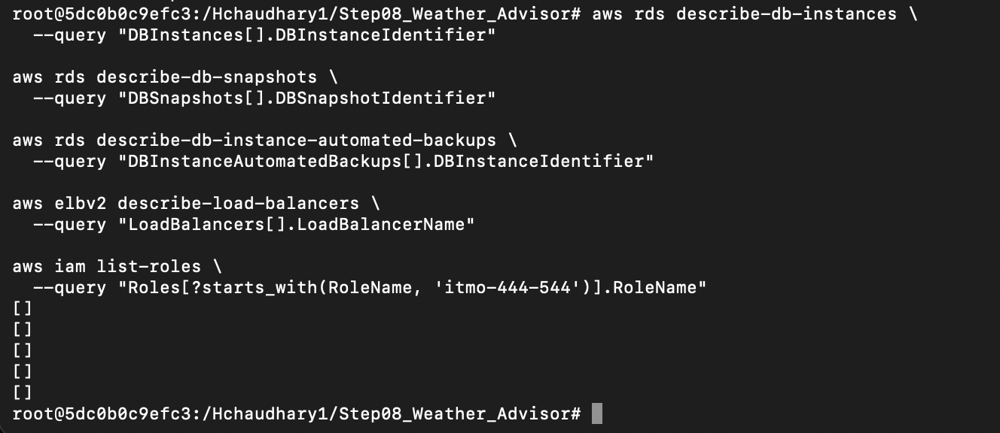

---

# 58. Screenshot Evidence

| No. | Screenshot | What It Proves |
|---|---|---|
| 01 | `01_project_structure.png` | Final Weather Advisor project structure |
| 02 | `02_nws_weather_api.png` | NWS API successfully returns forecast information |
| 03 | `03_gemini_ssm_securestring.png` | Gemini key stored as an SSM SecureString |
| 04 | `04_database_created.png` | PostgreSQL RDS database successfully created |
| 05 | `05_database_verified.png` | Required RDS configuration |
| 06 | `06_weather_stack_created.png` | ALB, target groups, listeners, launch templates, and ASGs created |
| 07 | `07_advisor_gemini_success.png` | Advisor successfully generated Gemini advice |
| 08 | `08_iam_least_privilege.png` | Initial IAM policy configuration |
| 09 | `09_weather_healthy_before_chaos.png` | Weather healthy before EC2 failure |
| 10 | `10_advisor_weather_outage_502.png` | Advisor returned 502 during Weather outage |
| 11 | `11_weather_recovered_after_outage.png` | Replacement Weather instance became healthy |
| 12 | `12_chaos_tests_passed.png` | Automated chaos tests passed |
| 13 | `13_unit_and_integration_tests_passed.png` | Unit/moto and integration tests passed |
| 14 | `14_final_cleanup_verified.png` | Final AWS cleanup verification |
| 15 | `15_smoke_test_9_of_9.png` | Required application smoke test passed 9/9 |
| 16 | `16_weather_journal.png` | Structured Weather logs and cache hit/miss timing |
| 17 | `17_psql_history.png` | Lookup records stored directly in PostgreSQL |
| 18 | `18_direct_vs_alb.png` | Direct instance application access blocked while ALB works |
| 19 | `19_gemini_fallback_error.png` | Invalid Gemini credential triggers fallback and `gemini_error` |
| 20 | `20_gemini_restored_success.png` | Gemini restored successfully |
| 21 | `21_iam_policy_simulator.png` | Both roles tested against both secrets |
| 22 | `22_history_endpoint.png` | `/history` successfully reads PostgreSQL records |
| 23 | `23_advisor_web_page.png` | User-facing Advisor page displays Gemini recommendation |
| 24 | `24_cache_timing.png` | Cache-hit request is much faster than initial request |
| 25 | `25_db_failure_log.png` | DB outage causes `cache=unavailable`, `/history` 503, and `db_error` |
| 26 | `26_db_recovery.png` | PostgreSQL recovered and cache returned `hit` |

---

# 59. Final Test Results

~~~text
Database-specific Moto:
4 passed

Complete Unit / Moto Suite:
27 passed
20 deselected

Integration Tests:
18 passed
29 deselected

Chaos Tests:
2 passed
41 deselected

Application Smoke Test:
9 of 9 checks passed

Weather Recovery:
approximately 112.5 seconds

Required Recovery Objective:
<= 300 seconds
~~~

All required automated tests and application experiments passed.

---

# 60. Graduate ITMO 544 Checklist

## Python Infrastructure

- [x] `create_database.py`
- [x] `delete_database.py`
- [x] `create_weather_stack.py`
- [x] `delete_weather_stack.py`
- [x] Infrastructure implemented using Python and boto3
- [x] Python code split into reusable modules
- [x] Required PostgreSQL RDS configuration
- [x] Password generated with `secrets.token_hex(16)`
- [x] DB password stored in SSM SecureString
- [x] Gemini key stored in SSM SecureString
- [x] Weather role restricted to DB secret
- [x] Advisor role restricted to Gemini secret
- [x] IAM Policy Simulator verification
- [x] ALB and two listeners
- [x] Weather and Advisor Target Groups
- [x] Weather and Advisor Launch Templates
- [x] Weather and Advisor Auto Scaling Groups
- [x] ALB created before Advisor Launch Template
- [x] Advisor user-data receives ALB DNS
- [x] Weather user-data receives DB host
- [x] Secrets excluded from user-data
- [x] User-data below 16 KB
- [x] Idempotent resource creation
- [x] Safe repeated deletion behavior
- [x] No secrets committed to GitHub
- [x] AWS error handling included

## Application Verification

- [x] NWS API response verified
- [x] Two-step NWS request flow explained
- [x] Weather endpoint verified
- [x] Advisor JSON verified
- [x] Advisor browser page verified
- [x] Application smoke test passed 9/9
- [x] Invalid ZIP returns 400
- [x] Unknown ZIP returns 404
- [x] Weather journal inspected
- [x] `weather_success` log explained
- [x] `/history` endpoint verified
- [x] PostgreSQL verified directly with `psql`
- [x] Cache miss/hit timing tested
- [x] Cache TTL tradeoff explained

## Security

- [x] RDS is private
- [x] RDS is encrypted
- [x] Multi-AZ disabled as required
- [x] Automated backup retention set to zero as required
- [x] PostgreSQL port limited to application SG
- [x] Application port limited to ALB SG
- [x] Direct EC2 application access blocked
- [x] Security Group source behavior explained
- [x] IAM least privilege verified for both roles and both secrets
- [x] SSM secret-storage advantages explained
- [x] Backup-retention tradeoff explained
- [x] Third-party AI privacy considerations discussed

## Failure Experiments

- [x] Gemini credential intentionally invalidated
- [x] Fallback response verified
- [x] `gemini_error` logs verified
- [x] Silent-fallback weakness explained
- [x] Gemini restored successfully
- [x] Database connectivity intentionally interrupted
- [x] Weather remained available
- [x] `cache = unavailable` verified
- [x] `/history` returned 503 during DB outage
- [x] `db_error` journal entry verified
- [x] Database retry-pause behavior explained
- [x] Database access restored
- [x] Cache recovery verified
- [x] Weather EC2 intentionally terminated
- [x] Advisor returned 502 during Weather outage
- [x] Auto Scaling launched replacement
- [x] Weather recovered within 300 seconds
- [x] Persistent state location explained

## Unit / Moto Tests

- [x] `db.t4g.micro`
- [x] Backup retention = 0
- [x] Multi-AZ = false
- [x] Publicly accessible = false
- [x] Storage encrypted = true
- [x] DB Security Group restricts port 5432
- [x] No public DB CIDR
- [x] Database create/delete tested
- [x] Password parameter behavior tested
- [x] IAM policy behavior tested
- [x] Advisor user-data contains ALB DNS
- [x] Weather user-data contains DB host
- [x] Secrets absent from user-data
- [x] User-data size tested
- [x] Idempotency tested
- [x] Moto limitations explained

## Integration Tests

- [x] Target Groups healthy
- [x] Weather endpoint works
- [x] Cache miss/hit verified
- [x] `/history` verified
- [x] Invalid ZIP returns 400
- [x] Unknown ZIP returns 404
- [x] Advisor returns clothing advice
- [x] Instances protected behind ALB
- [x] Database not publicly reachable
- [x] RDS configuration verified
- [x] IAM least privilege verified

## Cleanup

- [x] Auto Scaling Groups removed
- [x] Application Load Balancer removed
- [x] Target Groups removed
- [x] Launch Templates removed
- [x] IAM roles/profiles removed
- [x] RDS instance removed
- [x] DB subnet group removed
- [x] RDS snapshots verified empty
- [x] Automated backups verified empty
- [x] DB password parameter removed
- [x] Gemini API-key parameter removed during final cleanup
- [x] Final cleanup verified using AWS CLI

---

# 61. Final Result

The Weather Advisor project demonstrates a complete cloud application with infrastructure, application, security, testing, observability, failure recovery, and cleanup.

The final solution includes:

~~~text
Python + boto3 infrastructure automation
Two application tiers
Application Load Balancer
Two listeners
Two Target Groups
Two Auto Scaling Groups
PostgreSQL on Amazon RDS
PostgreSQL-backed caching
Persistent lookup history
Zippopotam API
National Weather Service API
Google Gemini
SSM SecureString secrets
Least-privilege IAM
IAM Policy Simulator verification
Secure Security Groups
Structured application logs
Graceful database degradation
Gemini fallback behavior
Moto unit testing
Real AWS integration testing
Application smoke testing
Chaos testing
Automatic EC2 recovery
Idempotent infrastructure
Python-based deletion
Final AWS cleanup verification
~~~

Final automated results:

~~~text
27 unit/moto tests passed
18 integration tests passed
2 chaos tests passed
9 of 9 application smoke checks passed
~~~

Measured Weather recovery:

~~~text
approximately 112.5 seconds
~~~

Required recovery objective:

~~~text
<= 300 seconds
~~~

The project successfully demonstrates that the Weather and Advisor tiers operate correctly during normal conditions, handle database and AI-provider failures, recover from EC2 failure through Auto Scaling, protect secrets using SSM and IAM, and can be completely removed from AWS after the assignment.
