# ITMO 444/544 — Lab 07: Infrastructure as Code with Terraform

## Rebuild the Weather Advisor with Terraform

**Student:** Himanshu Chaudhary  
**AWS Region:** `us-east-2`  
**Terraform Version:** `v1.17.2`  
**AWS Provider:** `v5.100.0`

---

# 1. Lab Overview

The purpose of this lab was to rebuild the Weather Advisor infrastructure using Terraform and compare a declarative Infrastructure as Code approach with the imperative infrastructure automation used in the previous lab.

The Terraform deployment managed the infrastructure required for two application tiers:

- Weather service
- Advisor service

The AWS infrastructure included:

- Application Load Balancer
- ALB listeners
- Target groups
- EC2 Launch Templates
- Auto Scaling Groups
- EC2 instances
- Security Groups
- DynamoDB
- IAM roles
- IAM instance profiles
- AWS Systems Manager Parameter Store
- User-data configuration
- Terraform outputs
- Terraform state

The experiments in the lab demonstrated:

- declarative Infrastructure as Code
- Terraform plans
- Terraform state
- idempotence
- dependency graphs
- resource replacement
- targeted infrastructure changes
- Auto Scaling instance refresh
- configuration drift detection
- drift repair
- IAM least privilege
- secret handling
- graceful application fallback
- Terraform destruction
- final AWS cleanup verification

---

# 2. Terraform and AWS Environment

The environment used for the lab was:

```text
AWS Region: us-east-2
Terraform: v1.17.2
AWS Provider: v5.100.0
```

The AWS identity was checked with:

```bash
aws sts get-caller-identity
```

The account number was hidden from submitted evidence as required.

The final Terraform version and masked AWS identity are also shown later in the Step 10 evidence.

---

# 3. Part A — First Taste of Terraform

Part A demonstrated the basic Terraform workflow on a very small example before building the complete Weather Advisor infrastructure.

---

## Part A.1 — Initial Terraform Plan

### Screenshot Path

`screenshots/00_partA_first_terraform_plan.png`

### Screenshot

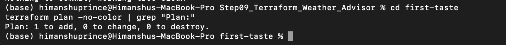

### Evidence

The first plan showed:

```text
Plan: 1 to add, 0 to change, 0 to destroy.
```

This means Terraform compared the configuration with the current state and determined that one new resource needed to be created.

Terraform had not yet applied the desired state, so the resource appeared with the `+` create action.

---

## Part A.2 — First Apply and Second Apply

After applying the configuration once, the same configuration was applied again.

The second application resulted in:

```text
No changes.
Your infrastructure matches the configuration.
```

This demonstrates **idempotence**.

Idempotence means that once the actual infrastructure matches the desired Terraform configuration, running Terraform again does not repeatedly recreate or modify resources.

This is an important improvement over imperative automation because Terraform compares the desired state, Terraform state, and the real infrastructure before determining what action is required.

---

## Part A.3 — In-Place Update

A tag value was changed during the Part A experiment.

Terraform represented the modification using:

```text
~
```

The `~` symbol means:

```text
update in-place
```

The existing resource does not have to be destroyed. Terraform can modify the appropriate property while preserving the same underlying resource.

---

## Part A.4 — Replacement Plan

A property that required resource replacement was then changed.

Terraform represented the change with:

```text
-/+
```

This means:

```text
destroy and then create replacement
```

The replacement change was not applied during the experiment.

### Why `-/+` Requires Special Attention

`-/+` is the plan symbol I would be most careful about because the existing resource will be destroyed and replaced.

A replacement can cause:

- service interruption
- temporary unavailability
- a changed resource ID
- a changed IP address or endpoint
- data loss for stateful resources if they are not protected

For this reason, a Terraform plan should always be read carefully before applying a change that contains `-/+`.

---

# 4. Part B — Weather Advisor Application

The application consists of two tiers.

## Weather Application

The Weather service:

- accepts a U.S. ZIP code
- resolves the location
- retrieves National Weather Service forecast information
- stores/reuses weather lookups with DynamoDB
- uses a configurable cache duration
- exposes health and weather endpoints

The Weather application receives configuration through environment variables created by Terraform user-data.

---

## Advisor Application

The Advisor service:

- receives a ZIP code
- calls the Weather service
- retrieves the Gemini API key from Parameter Store
- asks Gemini for clothing advice
- returns rule-based fallback advice if Gemini fails

The fallback design allows the service to continue providing a useful response even when the external AI dependency is unavailable.

---

# 5. Part C — Terraform Configuration

The Terraform configuration was separated into files based on responsibility:

```text
versions.tf
variables.tf
locals.tf
network.tf
storage.tf
iam.tf
alb.tf
compute.tf
outputs.tf
user-data.sh.tftpl
terraform.tfvars
```

This separation makes the infrastructure easier to understand and maintain.

---

## Terraform Initialization

Terraform was initialized with:

```bash
terraform init
```

Terraform downloaded the required AWS provider and created the dependency lock file:

```text
.terraform.lock.hcl
```

The lock file is committed to the repository so that future users receive the same provider version selected for this configuration.

---

## Terraform Formatting

The configuration was checked with:

```bash
terraform fmt
```

`terraform fmt` completed successfully.

When files are already correctly formatted, `terraform fmt` may return without additional output.

---

## Terraform Validation

The configuration was validated with:

```bash
terraform validate
```

Result:

```text
Success! The configuration is valid.
```

Validation checks Terraform syntax and configuration consistency before infrastructure is created.

---

## Initial Full-Stack Plan

The full Weather Advisor plan showed:

```text
Plan: 25 to add, 0 to change, 0 to destroy.
```

Terraform therefore identified 25 managed infrastructure resources that needed to be created.

This is different from Part A, where the small `first-taste` experiment required only one resource.

---

# 6. IAM Troubleshooting During Deployment

During deployment, temporary additional IAM permission was required for SSM tagging operations.

### Screenshot Path

`screenshots/01_troubleshooting_iam_ssm_tag_access_policy.png`

### Screenshot

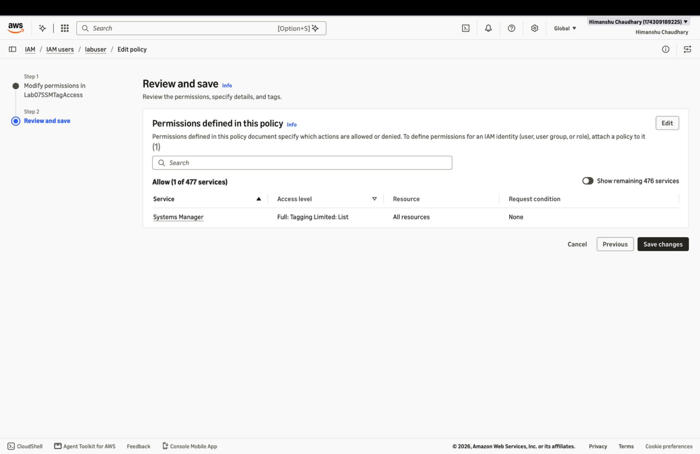

### Explanation

Terraform can only perform AWS operations that are allowed to the AWS identity executing it.

The temporary IAM permission allowed the required Parameter Store tagging action so deployment could continue.

After the lab was completed, the temporary troubleshooting policy was deleted.

This was important because temporary debugging permissions should not remain attached after they are no longer required.

---

# 7. Part E — Deployment and Application Testing

## Manual Weather, Cache, and Gemini Test

### Screenshot Path

`screenshots/02_manual_weather_cache_and_gemini_test.png`

### Screenshot

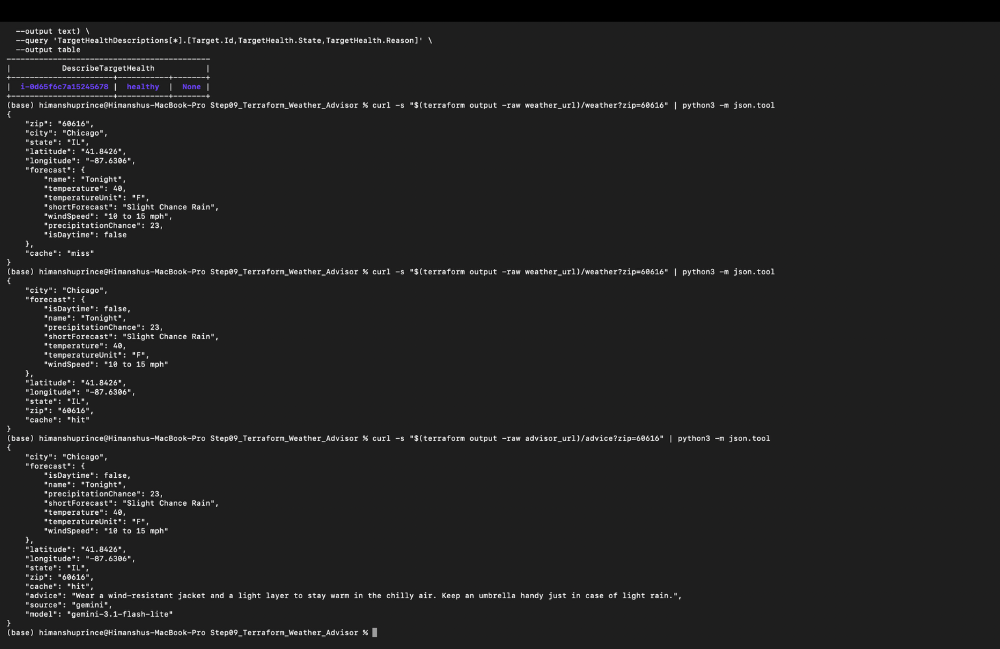

### Explanation

This evidence shows successful manual testing after Terraform deployed the infrastructure.

The Weather service responded successfully and demonstrated caching behavior.

The Advisor service successfully returned an AI-generated clothing recommendation.

The request path was approximately:

```text
Client
   |
   v
Application Load Balancer
   |
   +---- Weather listener ----> Weather service ----> Weather APIs / DynamoDB
   |
   +---- Advisor listener ----> Advisor service ----> Weather service
                                      |
                                      v
                                   Gemini API
```

This confirmed that the Terraform-managed resources were integrated successfully.

---

## Application Smoke Test

### Screenshot Path

`screenshots/03_smoke_test_9_of_9_passed.png`

### Screenshot

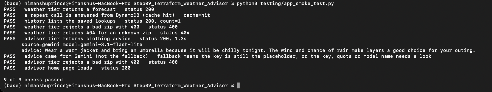

### Result

```text
9 of 9 checks passed
```

### Explanation

The smoke test checked the important application behaviors after deployment.

All nine checks passed, demonstrating that the Terraform-created stack was working before the experiments in Part F began.

The tests included successful Weather and Advisor behavior and confirmation that the recommendation was coming from Gemini rather than the fallback path.

---

# 8. Part F — Experiments

# Step 1 — Count the Effort

### Screenshot Path

`screenshots/04_step1_effort_line_counts.png`

### Screenshot

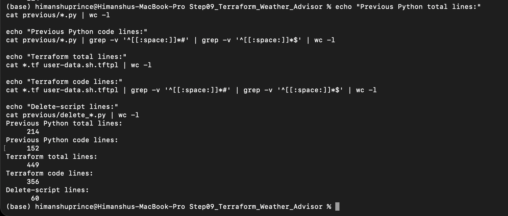

### Recorded Results

```text
Previous Python infrastructure total lines: 214
Previous Python code lines: 152

Terraform total lines: 449
Terraform code lines: 356

Delete-script lines: 60
```

### Analysis

Terraform did not necessarily result in fewer total lines.

The important difference was the type of effort represented by those lines.

The previous imperative implementation required explicit logic for tasks such as:

- creating resources
- checking whether resources already existed
- determining operation order
- updating resources
- handling cleanup
- deleting resources
- handling retry behavior

Terraform provides these infrastructure lifecycle capabilities through its declarative model, state, dependency graph, plan, apply, and destroy operations.

Therefore, Terraform moved effort away from manually writing infrastructure orchestration logic and toward describing the desired state.

---

# Step 2 — Terraform Dependency Graph

### Screenshot Path

`screenshots/05_step2_terraform_dependency_graph.png`

### Screenshot

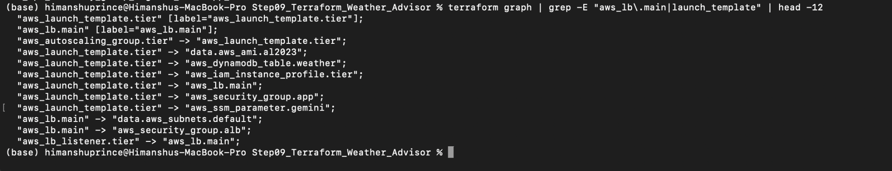

### Explanation

Terraform automatically builds a dependency graph from references between resources.

One important example in this lab was the Advisor launch configuration referencing the load balancer through the Weather URL.

The relevant dependency is created by a reference such as:

```text
aws_lb.main.dns_name
```

Because the Advisor configuration requires the ALB DNS name, Terraform knows the load balancer must exist before the Advisor launch-template configuration can be completed.

### What Happens if the Reference Is Removed?

If the `WEATHER_URL` configuration no longer referenced:

```text
aws_lb.main.dns_name
```

Terraform would no longer infer that dependency from that expression.

This demonstrates why resource references are not only convenient ways to get values; they also define relationships in Terraform's dependency graph.

---

# Step 3 — Idempotence

### Screenshot Path

`screenshots/06_step3_no_changes_idempotence.png`

### Screenshot

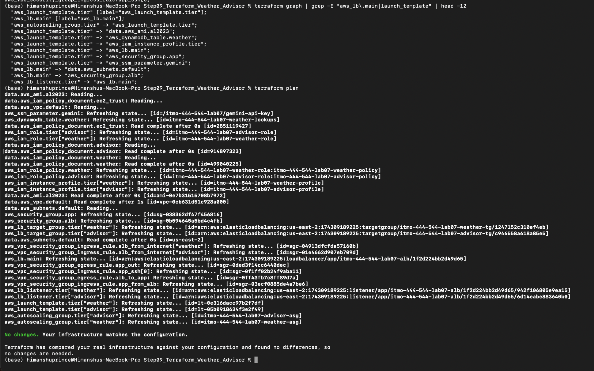

### Result

```text
No changes.
Your infrastructure matches the configuration.
```

### Explanation

Terraform compared:

```text
Terraform configuration
        +
Terraform state
        +
Actual AWS infrastructure
```

and determined that no work was required.

### Comparison With Running the Previous Script Twice

Running an imperative infrastructure script twice requires the script itself to contain logic that decides whether every resource already exists and whether it is correctly configured.

Terraform instead performs this comparison as part of its normal workflow.

A bash/Python script may find an existing resource and decide to skip it, even if one of its settings is wrong.

Terraform compares the managed attributes with the desired configuration and can therefore identify configuration drift rather than merely checking whether a resource exists.

---

# Step 4 — Change `cache_seconds`

The Weather cache duration was temporarily changed from:

```text
600
```

to:

```text
60
```

---

## Step 4.1 — Terraform Plan Details

### Screenshot Path

`screenshots/07_step4_cache_seconds_plan_details.png`

### Screenshot

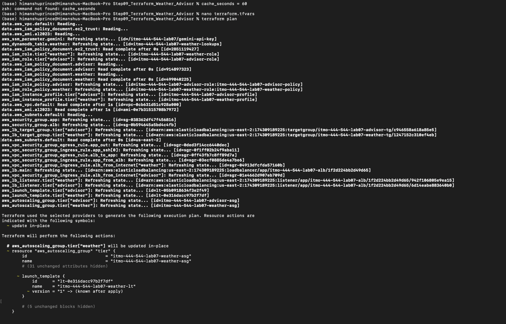

### Explanation

Terraform calculated which resources were affected by the configuration change.

The change did not require rebuilding the entire stack.

This demonstrates that Terraform uses its dependency graph and state to determine the **blast radius** of a configuration change.

---

## Step 4.2 — Plan Summary

### Screenshot Path

`screenshots/08_step4_cache_seconds_plan_summary.png`

### Screenshot

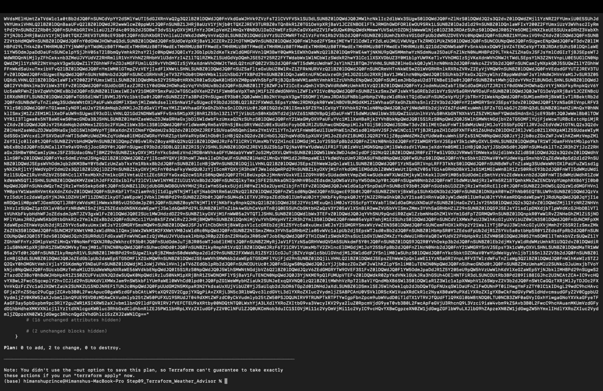

### Result

```text
Plan: 0 to add, 2 to change, 0 to destroy.
```

### Explanation

Only two resources required modification.

The database, load balancer, unrelated IAM resources, and other unaffected infrastructure did not need to be recreated.

---

## Step 4.3 — Auto Scaling Instance Refresh

### Screenshot Path

`screenshots/09_step4_instance_refresh_started.png`

### Screenshot

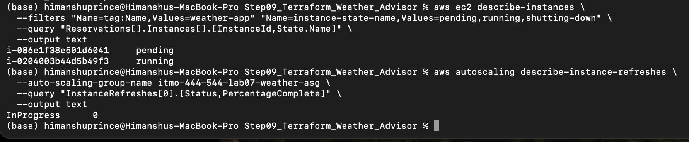

### Explanation

Updating the Weather launch-template configuration caused an Auto Scaling instance refresh.

Instance refresh allows the Auto Scaling Group to replace an instance created from an older launch-template configuration with an instance using the new configuration.

This gives Terraform a predictable method for deploying updated instance settings.

---

## Step 4.4 — Verify `CACHE_SECONDS=60`

### Screenshot Path

`screenshots/10_step4_cache_seconds_60_verified.png`

### Screenshot

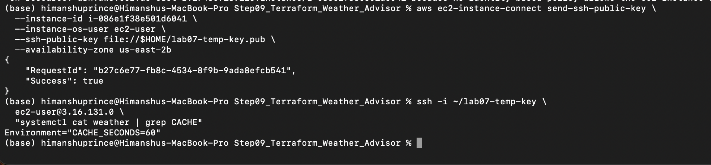

### Result

The new instance contained:

```text
Environment="CACHE_SECONDS=60"
```

### Explanation

This proves the change was not only represented in the Terraform plan. It propagated to the actual running EC2 instance.

After verifying the result, the cache setting was changed back to its normal value of:

```text
600
```

and Terraform was applied again.

---

# Step 5 — Cause Drift and Watch Terraform Detect It

Configuration drift is a difference between the desired Terraform configuration and the real infrastructure.

---

## Step 5.1 — Health Check Drift

The Weather target-group health-check path was manually changed outside Terraform.

### Screenshot Path

`screenshots/11_step5_health_check_drift_plan.png`

### Screenshot

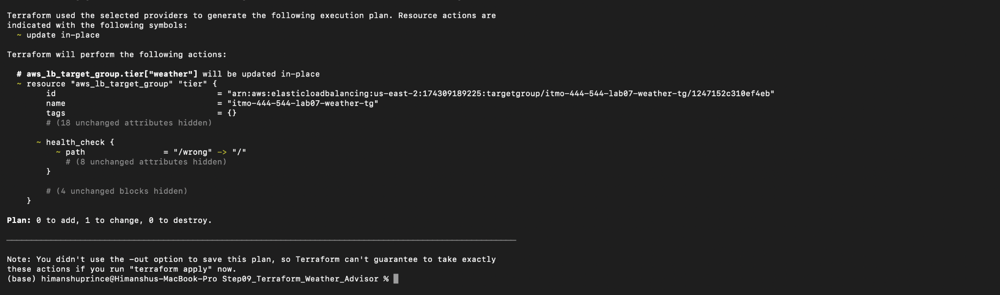

### Explanation

Terraform detected that the health-check path in AWS no longer matched the value defined in the Terraform configuration.

The Terraform plan showed an in-place update that would restore the correct path.

This demonstrates drift detection.

---

## Step 5.2 — Target Group Recovery

### Screenshot Path

`screenshots/12_step5_target_group_recovery.png`

### Screenshot

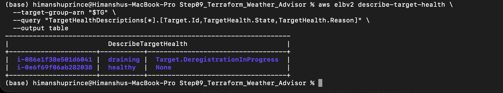

### Explanation

After Terraform reapplied the correct health-check configuration, the Weather target recovered and returned to a healthy state.

This demonstrates that Terraform can be used not only to detect drift but also to repair it.

---

## Step 5.3 — Delete the Advisor Listener

The Advisor listener was then deleted manually outside Terraform.

### Screenshot Path

`screenshots/13_step5_deleted_listener_plan_1_add.png`

### Screenshot

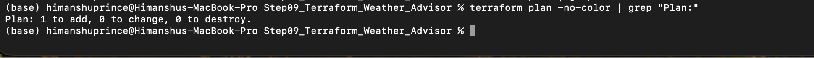

### Result

```text
Plan: 1 to add, 0 to change, 0 to destroy.
```

Terraform recognized that a resource declared in configuration was completely missing and proposed recreating it.

### Comparison With Lab06 `ensure_target_group`

The previous `ensure_target_group` approach could find an existing resource and report that it was already present without checking whether every property still matched the intended configuration.

Terraform instead compares the actual managed attributes with the declared desired state.

That is why Terraform detected both:

1. a resource whose configuration had drifted, and
2. a resource that had been deleted completely.

---

# Step 6 — IAM Least Privilege

### Screenshot Path

`screenshots/14_step6_iam_policy_simulator.png`

### Screenshot

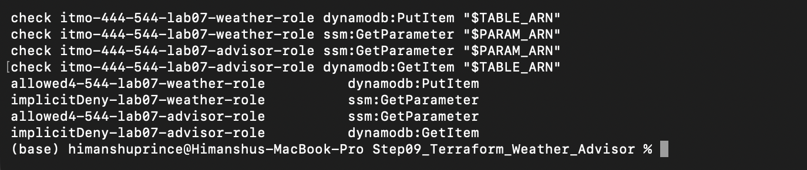

### Results

| Role | Action | Result |
|---|---|---|
| Weather role | `dynamodb:PutItem` | `allowed` |
| Weather role | `ssm:GetParameter` | `implicitDeny` |
| Advisor role | `ssm:GetParameter` | `allowed` |
| Advisor role | `dynamodb:GetItem` | `implicitDeny` |

### Explanation

These results demonstrate least privilege.

The Weather service requires DynamoDB access to store/retrieve weather information, but it does not need access to the Gemini secret.

The Advisor service needs access to the Gemini Parameter Store value, but it does not need direct access to the Weather DynamoDB table.

### Why the Advisor Tier Is Safer

If the Advisor service were compromised, its IAM role would not automatically give the attacker DynamoDB access.

Similarly, compromise of the Weather service would not provide permission to retrieve the Gemini secret.

Dividing permissions by application responsibility reduces the blast radius of a compromised service.

---

# Step 7 — Terraform State and Secret Handling

### Screenshot Path

`screenshots/15_step7_no_changes_and_state_key_check.png`

### Screenshot

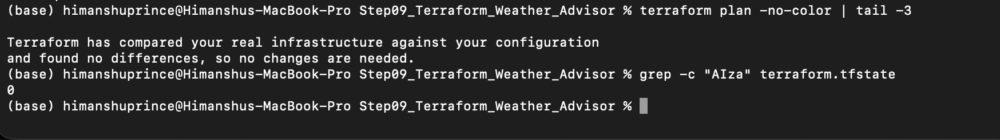

### Terraform Plan

The plan reported:

```text
No changes.
```

even though the real SSM parameter value had been updated separately.

### API Key Search

The state was checked with:

```bash
grep -c "AIza" terraform.tfstate
```

Result:

```text
0
```

The real Gemini API key pattern therefore did not appear in the state search.

---

## `ignore_changes`

The SSM parameter Terraform configuration used:

```hcl
lifecycle {
  ignore_changes = [value]
}
```

This tells Terraform not to attempt to reconcile changes made to that resource attribute outside Terraform after creation.

### What Would Happen if `ignore_changes` Were Removed?

If `ignore_changes = [value]` were removed, the next Terraform plan/apply would compare the real SSM value with the value declared in the Terraform configuration.

Terraform would then attempt to change the parameter back to the configuration value.

That would risk replacing the real Gemini API key with the placeholder value.

The relevant parameter value could also be represented in Terraform plan/state information, which is why both state files and saved Terraform plan files must be treated as sensitive.

---

# Step 8 — Break Gemini and Verify Graceful Fallback

The stored Gemini parameter was temporarily overwritten with:

```text
not-a-real-key
```

After waiting for the Advisor key cache to expire, the application was tested again.

---

## Step 8.1 — Fallback Answers

### Screenshot Path

`screenshots/16_step8_fallback_responses.png`

### Screenshot

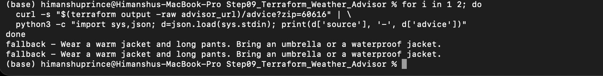

### Result

The requests returned responses similar to:

```text
fallback - Wear a warm jacket and long pants. Bring an umbrella or a waterproof jacket.
```

The application still returned HTTP success responses and useful clothing advice even though Gemini was unavailable.

This demonstrates graceful degradation.

---

## Step 8.2 — Gemini Error Logs

### Screenshot Path

`screenshots/17_step8_gemini_error_logs.png`

### Screenshot

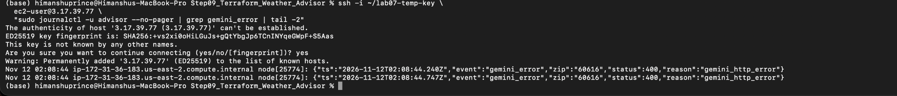

### Log Evidence

The Advisor logs contained entries such as:

```text
"event":"gemini_error"
"status":400
"reason":"gemini_http_error"
```

This proves that the Gemini call was actually failing while the user continued receiving fallback advice.

---

## Problem With Silent Fallback

A design where users never see an error can hide an important system failure.

Users could continue receiving apparently successful responses even though the Gemini integration has been broken for hours or days.

If the only evidence is a `gemini_error` log line that nobody monitors, operators may not notice the failure.

A production system should therefore add:

- error metrics
- monitoring
- alarms
- dashboards
- alerting

Graceful degradation should improve availability without hiding failures from system operators.

---

## Step 8.3 — Restore Gemini

### Screenshot Path

`screenshots/18_step8_gemini_restored.png`

### Screenshot

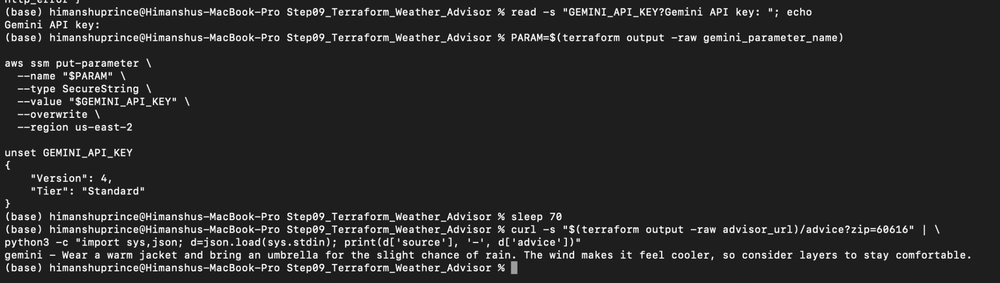

### Result

After the real key was restored, the Advisor again returned:

```text
gemini - Wear a warm jacket and bring an umbrella...
```

This confirmed successful recovery of the Gemini integration.

---

## Advisor Webpage Verification

### Screenshot Path

`screenshots/19_advisor_webpage_gemini.png`

### Screenshot

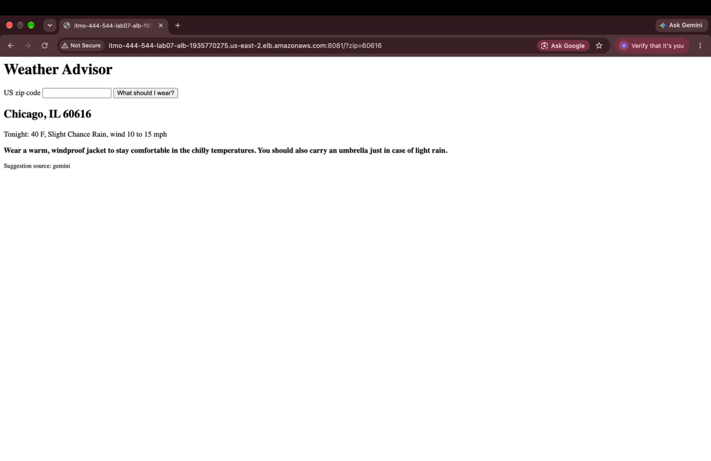

### Explanation

The browser interface was tested with ZIP code:

```text
60616
```

The page displayed Chicago weather information and clothing advice.

It also showed:

```text
Suggestion source: gemini
```

This verifies successful end-to-end application behavior through the user-facing Advisor page.

---

# Step 9 — EC2 Advisor vs Lambda Advisor

The professor asked which infrastructure exists only because the Advisor runs on EC2, what would remain if the Advisor were moved to Lambda, and what new resources or work would appear.

## Required Lambda Comparison Table

| Advisor on EC2 in This Lab | Advisor on Lambda | Effort Moved To |
|---|---|---|
| Advisor EC2 Launch Template and user-data | Lambda function resource and deployment package | Lambda removes EC2 bootstrapping; Terraform still provisions the function |
| Advisor Auto Scaling Group | Lambda automatic scaling | AWS Lambda |
| EC2 instance refresh | Deploy a new Lambda function/version | Lambda + deployment process |
| Advisor EC2 security-group rule for port 3000 | No EC2 application port required for the Lambda target | Lambda removes EC2 network management |
| Advisor EC2 instance profile | Lambda execution role | IAM is still required |
| Advisor EC2 IAM role | Lambda execution role with SSM access | Terraform/IAM remains |
| Node.js installation | Managed Lambda runtime | Lambda |
| systemd Advisor service | Lambda handler | Application/Lambda runtime |
| EC2 health-check grace period | Lambda invocation/target health behavior | Lambda/monitoring |
| EC2 instance lifecycle management | No Advisor server instances | Lambda |
| ALB | Can remain | Terraform |
| Advisor ALB listener | Can remain | Terraform |
| Advisor target group | Remains but must use Lambda as the target type | Terraform |
| SSM Gemini parameter | Remains | Terraform/SSM |
| IAM policy permitting Gemini parameter access | Remains but attaches to Lambda execution role | Terraform/IAM |
| Weather service | Remains unchanged | Existing infrastructure |
| DynamoDB Weather table | Remains unchanged | Existing infrastructure |

---

## Resources That Exist Only Because Advisor Uses EC2

The following EC2-oriented components could be removed or replaced:

- Advisor Launch Template
- Advisor EC2 Auto Scaling Group
- Advisor EC2 instances
- Advisor application security-group rules needed for EC2 port 3000
- EC2 instance profile
- EC2-specific role attachment
- Node.js installation in user-data
- systemd Advisor service configuration
- EC2 instance refresh
- EC2 health-check grace-period behavior

---

## Resources That Would Stay

The following architecture components could remain:

- Application Load Balancer
- Advisor listener
- Parameter Store Gemini secret
- IAM policy granting access to the Gemini parameter
- Weather service
- Weather listener
- Weather target group
- DynamoDB table
- shared networking as required by the remaining infrastructure

The Advisor target group could still exist but would need to become a Lambda-compatible target group.

---

## New Lambda-Specific Work

A Lambda implementation would require:

- `aws_lambda_function`
- Lambda deployment package/artifact
- Lambda execution role
- permission allowing the ALB to invoke the Lambda function
- Lambda registration with the target group
- conversion of Express/request handling into a Lambda event/response model, or use of an adapter
- Lambda-specific logging and monitoring
- tests for Lambda event handling

---

## Question 4 — Who Removed the Effort?

Terraform and Lambda remove different types of effort.

**Terraform** removes much of the imperative infrastructure orchestration effort. It determines dependency order, tracks resources, detects drift, produces plans, and manages infrastructure lifecycle.

**Lambda** removes server-management effort. I would no longer need to maintain an Advisor EC2 instance, bootstrap Node.js, configure systemd, manage an Advisor Auto Scaling Group, or perform instance refreshes.

### What Would I Gain?

I would gain:

- less server administration
- automatic scaling
- no Advisor EC2 patching
- no Advisor instance bootstrapping
- simpler compute lifecycle management

### What New Problems Would I Take On?

Lambda would introduce new concerns such as:

- cold-start latency
- Lambda execution time limits
- adapting the application to Lambda event structures
- Lambda packaging/deployment
- different local testing
- function concurrency behavior
- monitoring serverless invocation failures

Therefore, Lambda reduces server effort but does not eliminate architecture or application complexity.

---

# 9. Short Written Answers Required by the Lab

## How Is Terraform Like AWS Lambda?

Terraform and Lambda both let the developer move low-level operational work to a platform/tool.

Terraform removes the need to manually execute every infrastructure creation step.

Lambda removes the need to manually manage a server for application execution.

## Where Does the Comparison Stop?

Terraform is an **Infrastructure as Code provisioning and state-management tool**.

Lambda is a **compute service that executes application code**.

Terraform manages infrastructure lifecycle, while Lambda runs application logic.

---

## What Did Terraform Not Make Easier?

Terraform did not remove the need to understand:

- AWS architecture
- IAM permissions
- networking
- application failures
- external API behavior
- Gemini errors
- application logging
- monitoring
- secret-management risks
- cost management

Terraform made infrastructure lifecycle management more predictable, but it did not automatically solve application or operational problems.

---

# 10. Section 13.1 — Review Questions

## 10.1 Declarative vs Imperative

### Question

Give one thing the imperative version could do that is hard in Terraform, and one thing Terraform did that the imperative version never did.

### Answer

Imperative Python/bash code can easily perform arbitrary procedural operations in a specific sequence, including custom branching, loops, and application-specific recovery logic.

Terraform is less appropriate for arbitrary procedural workflows because it is designed around a desired state.

Terraform, however, automatically tracked managed resource state and detected configuration drift. The earlier imperative scripts did not automatically compare every managed resource attribute with a saved desired-state model.

---

## 10.2 State File

### Question

What would happen if the Terraform state were lost? What would happen if two people applied from different copies? How do teams solve this?

### Answer

If the state file were lost while the AWS resources still existed, Terraform would lose its mapping between Terraform resource addresses and the real AWS resource IDs.

A future apply could attempt to create duplicate resources or require existing resources to be imported back into state.

If two people independently apply from different state copies, each person may have a different view of infrastructure. This can cause conflicting changes, accidental overwrites, or duplicate resources.

Teams solve this by using **remote shared state and state locking**, for example an appropriately secured remote Terraform backend.

---

## 10.3 Secrets in State

### Question

Where else could a secret reach state or a plan file? Why is a plan file also sensitive?

### Answer

Secrets can reach Terraform state whenever secret values are passed as managed resource arguments or returned as resource attributes.

They may also appear in:

- resource attributes
- outputs
- data sources
- provider-managed values
- saved plan files

A saved Terraform plan can contain the values Terraform intends to apply, including sensitive infrastructure information.

For this reason, both:

```text
terraform.tfstate
```

and saved plan files such as:

```text
tfplan
```

must be treated as sensitive and should not be committed publicly.

---

## 10.4 Plan Before Apply

### Question

What does reading a plan protect you from? Which plan symbol worries you most, and why?

### Answer

Reading the plan protects against unexpected infrastructure changes before they happen.

It allows the operator to see resources Terraform intends to:

```text
+ create
~ update
-/+ replace
- destroy
```

The symbol that worries me most is:

```text
-/+
```

because it means Terraform will replace an existing resource.

Replacement can produce downtime, changed identifiers, or data loss depending on the resource.

---

## 10.5 Version Pinning

### Question

What could go wrong with no provider version pin, and why commit `.terraform.lock.hcl`?

### Answer

Without a provider version constraint, a future installation could automatically select a newer provider with changed defaults, behavior, validation rules, or resource implementation.

That could cause a configuration that previously worked to behave differently.

The file:

```text
.terraform.lock.hcl
```

records the selected provider version and checksums.

Committing it improves reproducibility so other users and future runs use the same provider version selected for the project.

---

## 10.6 `for_each` vs `count`

### Question

Why does `for_each` handle removing one tier better than `count`?

### Answer

`for_each` identifies resources using stable keys.

For example:

```text
weather
advisor
```

If one keyed element is removed, Terraform can identify exactly which corresponding resource should disappear.

With `count`, resources are identified primarily by numeric indexes.

Removing an element can shift indexes and potentially cause Terraform to associate existing resources with different positions.

For logically named infrastructure tiers, `for_each` therefore provides more stable resource identity.

---

## 10.7 Ownership

### Question

What goes wrong when a tool and a person both edit the same resource?

### Answer

When Terraform and a person both modify the same resource, configuration drift occurs.

The person's manual change may later be reversed by Terraform because the Terraform configuration remains the declared desired state.

This creates unclear infrastructure ownership and can lead to unexpected changes.

A team should establish whether a resource or attribute is:

- Terraform-managed
- intentionally externally managed
- excluded through an explicit lifecycle rule

rather than allowing unmanaged overlapping ownership.

---

## 10.8 Drift

### Question

How could a team find drift automatically and regularly? Who should be allowed to change things by hand?

### Answer

A team could run:

```bash
terraform plan
```

on a schedule in CI/CD and alert when the plan reports unexpected changes.

For more controlled environments, infrastructure changes should normally flow through reviewed Terraform changes rather than direct console modification.

Manual production changes should be limited to authorized operators and emergency procedures.

Any emergency manual change should later be reconciled with Terraform configuration.

---

## 10.9 Blast Radius

### Question

What decides how much one change touches, and how could the blast radius be reduced further?

### Answer

The blast radius is influenced by:

- Terraform dependencies
- resource references
- which attributes require replacement
- module/resource boundaries
- shared infrastructure
- how application tiers are coupled

The `cache_seconds` experiment demonstrated a small blast radius because Terraform modified only resources associated with the Weather configuration.

The blast radius could be reduced further by:

- separating independent components
- avoiding unnecessary dependencies
- using smaller modules/stacks
- isolating state where appropriate
- separating stateful resources from frequently replaced compute resources

---

## 10.10 Least Privilege

### Question

Why is a resource reference safer than a manually typed ARN?

### Answer

A Terraform resource reference such as a resource's generated ARN directly connects the IAM policy to the resource Terraform created.

A manually typed ARN can contain:

- the wrong region
- wrong account
- wrong resource name
- outdated name
- copy/paste error

Using a Terraform reference also creates a dependency and keeps the policy synchronized with the actual resource.

---

## 10.11 Terraform and Lambda

### Question

What does Terraform have in common with Lambda, and what is the most important difference?

### Answer

Both reduce low-level operational work.

Terraform automates infrastructure lifecycle management from declarative configuration.

Lambda removes server lifecycle management for application compute.

The most important difference is that Terraform is a provisioning/state-management tool, while Lambda is an execution environment for application code.

Terraform can actually be used to provision Lambda.

---

## 10.12 Destroy

### Question

Which resources would you protect from a careless destroy in a real environment, and how?

### Answer

In production I would especially protect stateful or difficult-to-recover resources such as:

- production databases
- persistent storage
- critical S3 buckets
- important DynamoDB tables
- production networking components
- critical shared infrastructure

Terraform provides lifecycle protection such as:

```hcl
lifecycle {
  prevent_destroy = true
}
```

This causes Terraform to reject a plan that would destroy the protected resource unless the protection is intentionally changed first.

Backups, restricted IAM permissions, plan review, and environment separation should also be used.

---

# 11. Step 10 — Destroy and Prove Nothing Is Left

Before destruction, the final Terraform state was checked.

---

## Step 10.1 — Final No-Change Plan, Terraform Version, and AWS Identity

### Screenshot Path

`screenshots/20_final_no_changes_terraform_version_sts.png`

### Screenshot

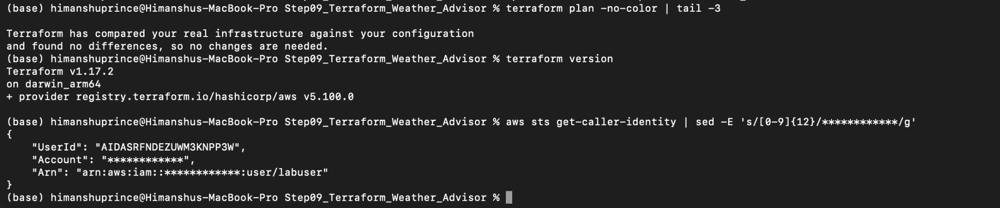

### Evidence

The final environment showed:

```text
Terraform v1.17.2
AWS Provider v5.100.0
```

The AWS identity was verified and the account number was masked.

Terraform also reported no unexpected infrastructure changes before destruction.

---

## Step 10.2 — Destroy Plan

### Screenshot Path

`screenshots/21_step10_destroy_plan_25_resources.png`

### Screenshot

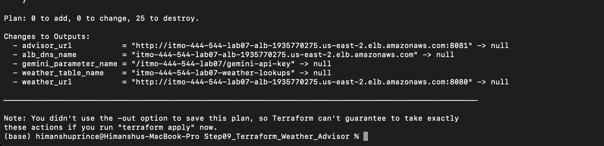

### Result

```text
Plan: 0 to add, 0 to change, 25 to destroy.
```

### Explanation

Terraform showed the destruction plan before deleting anything.

This provided an opportunity to confirm that the expected Terraform-managed resources were being removed and that Terraform was not planning to create or modify additional infrastructure during cleanup.

---

## Step 10.3 — Destroy Complete

### Screenshot Path

`screenshots/22_step10_destroy_complete_25.png`

### Screenshot

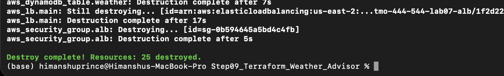

### Result

```text
Destroy complete! Resources: 25 destroyed.
```

### Destroy Time

```text
[ENTER ACTUAL TERRAFORM DESTROY DURATION] minutes
```

This single Terraform destroy operation replaced the custom cleanup logic that had been required by the previous imperative infrastructure implementation.

---

# 12. Cost Estimate

The lab document gives approximately the following hourly costs:

| Resource | Approximate Hourly Cost |
|---|---:|
| Application Load Balancer | $0.03/hour |
| Two `t3.micro` instances | $0.02/hour |
| Public IPv4 addresses | $0.02/hour |
| EBS volumes | less than $0.002/hour |
| DynamoDB | fractions of a cent |
| Parameter Store standard parameter | Free |
| Gemini free tier | Free |

Approximate stack cost:

```text
$0.03 + $0.02 + $0.02 + $0.002
≈ $0.072/hour
```

### Estimated Stack Runtime

```text
[ENTER ACTUAL NUMBER OF HOURS STACK WAS RUNNING] hours
```

### Estimated Lab Cost

Use:

```text
runtime × hourly cost
```

Therefore:

```text
[ENTER HOURS] × $0.072/hour = $[ENTER CALCULATED COST]
```

This is an estimate because DynamoDB and other usage-based charges are very small and actual AWS billing can vary slightly.

---

# 13. Cleanup Verification

## Terraform State and Temporary Access Cleanup

### Screenshot Path

`screenshots/23_step10_cleanup_verification.png`

### Screenshot

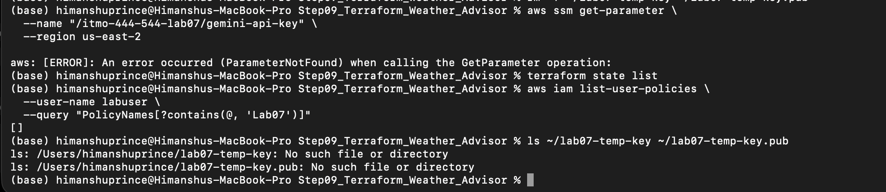

### Evidence

The Gemini SSM parameter check returned:

```text
ParameterNotFound
```

The following command returned no managed resources:

```bash
terraform state list
```

Temporary troubleshooting items were also removed, including:

- temporary IAM permission used for EC2 Instance Connect
- temporary IAM permission used for SSM tagging
- temporary local SSH key files

---

## Final AWS Resource Verification

### Screenshot Path

`screenshots/24_step10_final_aws_resource_checks.png`

### Screenshot

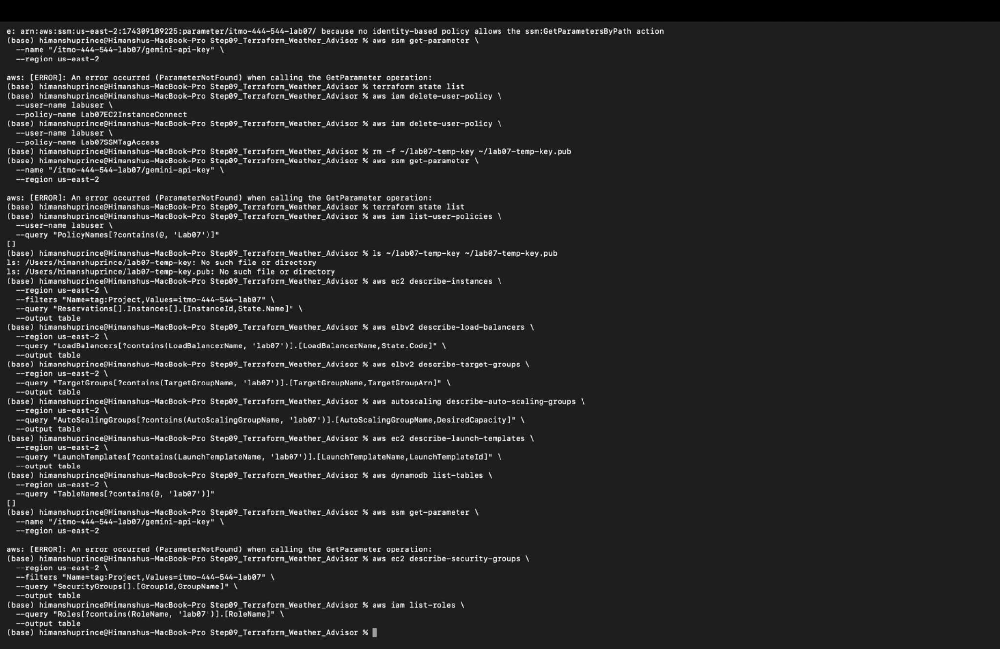

### Explanation

Final AWS checks were performed for Lab07 resources including:

- EC2 instances
- Application Load Balancers
- target groups
- Auto Scaling Groups
- Launch Templates
- DynamoDB
- SSM Parameter Store
- Security Groups
- IAM roles

No active Lab07 infrastructure remained.

This demonstrates that the Terraform-managed stack was successfully destroyed and that temporary troubleshooting resources were cleaned up.

---

# 14. Submission Evidence Summary

The following screenshot evidence is included in the repository:

```text
screenshots/00_partA_first_terraform_plan.png
screenshots/01_troubleshooting_iam_ssm_tag_access_policy.png
screenshots/02_manual_weather_cache_and_gemini_test.png
screenshots/03_smoke_test_9_of_9_passed.png
screenshots/04_step1_effort_line_counts.png
screenshots/05_step2_terraform_dependency_graph.png
screenshots/06_step3_no_changes_idempotence.png
screenshots/07_step4_cache_seconds_plan_details.png
screenshots/08_step4_cache_seconds_plan_summary.png
screenshots/09_step4_instance_refresh_started.png
screenshots/10_step4_cache_seconds_60_verified.png
screenshots/11_step5_health_check_drift_plan.png
screenshots/12_step5_target_group_recovery.png
screenshots/13_step5_deleted_listener_plan_1_add.png
screenshots/14_step6_iam_policy_simulator.png
screenshots/15_step7_no_changes_and_state_key_check.png
screenshots/16_step8_fallback_responses.png
screenshots/17_step8_gemini_error_logs.png
screenshots/18_step8_gemini_restored.png
screenshots/19_advisor_webpage_gemini.png
screenshots/20_final_no_changes_terraform_version_sts.png
screenshots/21_step10_destroy_plan_25_resources.png
screenshots/22_step10_destroy_complete_25.png
screenshots/23_step10_cleanup_verification.png
screenshots/24_step10_final_aws_resource_checks.png
```

---

# 15. Professor Submission Checklist

## 1. Terraform version and AWS identity

- Terraform version documented
- AWS identity checked
- account number hidden

**Status: Completed**

---

## 2. Part A

- first plan showing `1 to add`
- second apply showing `No changes`
- in-place update `~`
- replacement `-/+`
- explanation of why replacement deserves attention

**Status: Completed in write-up**

---

## 3. Terraform Formatting, Validation, and Initial Plan

- `terraform fmt`
- `terraform validate`
- initial full plan showing `25 to add`

**Status: Completed**

---

## 4. Application Smoke Test and Advisor Page

- all nine smoke-test checks passed
- Advisor web page verified

**Status: Completed**

---

## 5. Steps 1–3

- effort/line-count comparison
- dependency graph
- dependency explanation
- idempotence
- comparison with repeated imperative script execution

**Status: Completed**

---

## 6. Steps 4–5

- `cache_seconds=60` plan
- instance refresh
- `CACHE_SECONDS=60` verification
- health-check drift
- drift repair
- deleted listener
- `ensure_target_group` comparison

**Status: Completed**

---

## 7. Steps 6–7

- IAM simulator
- least-privilege explanation
- No Changes plan
- API key grep count of `0`
- `ignore_changes` explanation
- explanation of behavior without `ignore_changes`

**Status: Completed**

---

## 8. Steps 8–9

- fallback responses
- `gemini_error` log
- silent-fallback problem
- Gemini recovery
- Lambda comparison table
- Step 9 Question 4 analysis

**Status: Completed**

---

## 9. Short Answers and Section 13.1

- Terraform vs Lambda
- what Terraform did not make easier
- all Section 13.1 review questions

**Status: Completed**

---

## 10. Destroy, Cost, and Final Verification

- destroy plan
- 25 resources destroyed
- destroy duration
- cost estimate
- verification that no Lab07 resources remain

**Status: Completed except the two recorded time values marked above must be entered before final submission**

---

# 16. Final Conclusion

This lab demonstrated the difference between imperative infrastructure automation and declarative Infrastructure as Code.

The complete Weather Advisor infrastructure was successfully:

```text
planned
created
tested
modified
refreshed
drifted intentionally
repaired
security-tested
failure-tested
restored
destroyed
verified as removed
```

Terraform's most important advantages in this lab were not simply fewer commands or fewer lines of code.

The main advantages were:

- state management
- dependency tracking
- predictable plans
- idempotence
- drift detection
- targeted changes
- repeatable deployment
- repeatable destruction

At the same time, the lab showed that Terraform does not replace:

- application monitoring
- IAM design
- debugging
- secret protection
- architecture decisions
- cost awareness

Terraform provides a structured method for managing infrastructure, while application reliability and operational monitoring still require separate engineering practices.
